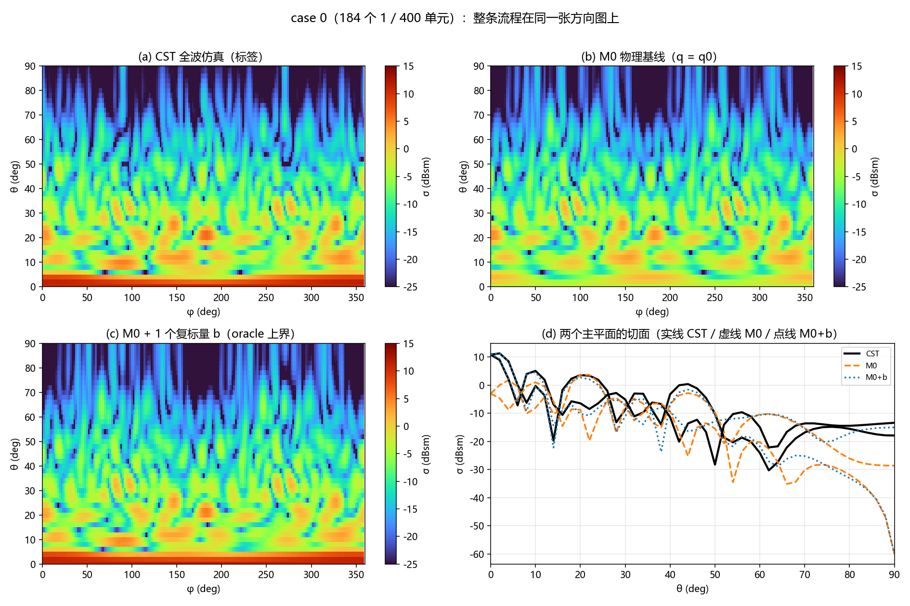
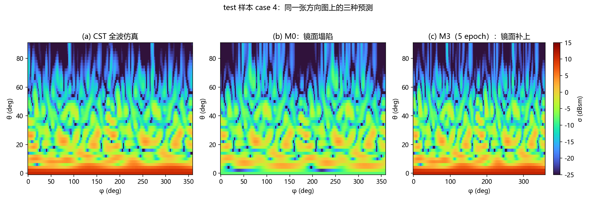
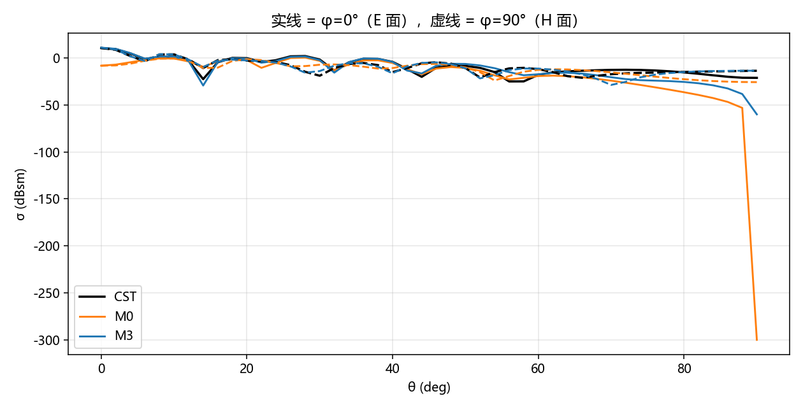

# 一份真实数据的全流程演示：case 0000

> 文档里的**每一个数字**都来自本机实际运行：`python walkthrough_demo.py`
> 数据 `D:/dataset/results/ff/ff_0000.txt` + `res_0000.json`，代码 `D:/GNN/gnn`（未改动）。
> 完整控制台输出：`demo_out/walkthrough_log.txt`；机器可读汇总：`demo_out/numbers.json`。

---

## 0 先看结论：同一条曲线上的几个状态

下面 4 行都是**同一个样本**（case 0000）。第 10 节会把 M3 真训 5 个 epoch，那是 44 个 test 样本的均值。

| | 镜面 σ (dBsm) | rho_lin | rho_db | rmse (dB) |
|---|---|---|---|---|
| **CST 全波仿真**（标签） | **+10.798** | 1 | 1 | 0 |
| **M0**（纯物理，0 参数） | **−3.012** | 0.3982 | 0.8600 | 4.656 |
| **M0 + 1 个复标量 b**（oracle，2 个实参数） | **+11.111** | 0.9959 | 0.8852 | 4.161 |
| **M3**（待训练）= M0 + Δq(GNN) + b | 初始化时 **= M0**（差 0.000e+00 dB） | — | — | — |

四句话：

1. 只靠"局部周期"物理（M0），**镜面差 13.810 dB**，弥散区却几乎是准的（rho_db 0.86、平均只偏 −0.70 dB）。
2. 给 M0 加**一个**复数 b（每样本 2 个实自由度），镜面立刻从 −3.01 抬到 +11.11 dBsm，`rho_lin` 从 0.40 跳到 0.996。
3. 但 `rmse` 只从 4.66 降到 4.16 —— **b 补的是"电平/整体形状"，补不了逐点的弥散结构**。
   这正是 M3 需要 Δq（每单元修正）的原因：b 负责全局，Δq 负责细部。
4. 真训 5 个 epoch 后，M3 在 44 个 **test** 样本上：镜面误差 **+0.16 dB**、rmse **2.64 dB**、
   rho_db **0.958**；学到的 **|b| = 0.3736**，与理论 0.37 只差 0.004（§10）。



---

## 1 样本：两个文件

| 文件 | 大小 | 内容 |
|---|---|---|
| `D:/dataset/results/ff/ff_0000.txt` | 358,507 B | 8280 行 × 4 列：`theta phi \|E_theta\|_dBsm \|E_phi\|_dBsm` |
| `D:/dataset/results/res_0000.json` | 365 B | 元数据 + 摘要指标 |

`res_0000.json` 全文（这就是"一个样本"的全部描述）：

```json
{
 "index": 0, "seed": 20261020, "block": 2,
 "code": "1101010001000100000000111101010000101101000100010011001100111111100000001000011010111110111010111001",
 "freq_ghz": 10.0, "ff_step": 2.0,
 "specular_dbsm": 10.798, "reduction_db": -8.542,
 "mean_far_dbsm": -6.559, "max_dbsm": 11.295,
 "solve_s": 294.5, "wall_s": 305.1, "mem_pct": 59,
 "done": "2026-10-21 11:07:35"
}
```

逐项含义：

| 字段 | 含义 | 本例 |
|---|---|---|
| `index` | 样本编号（文件名也用它） | 0 |
| `seed` | 生成随机码的种子（可复现） | 20261020 |
| `block` | 1 个码比特覆盖 `block×block` 个物理单元 | 2 |
| `code` | 100 个字符 = 10×10 的编码比特，行优先 | 46 个 `1` |
| `freq_ghz` / `ff_step` | 频率 / 远场角度步长 | 10 GHz / 2° |
| `specular_dbsm` | **θ=0（镜面）方向的 σ** | 10.798 |
| `reduction_db` | 相对 PEC 平板的降低量：10.798 − 19.342 = **−8.542** | −8.542 |
| `mean_far_dbsm` | θ∈[10°,90°] 的**线性功率均值**（不是 dB 均值） | −6.559 |
| `max_dbsm` | 8280 个点里 `\|E_θ\|²+\|E_φ\|²` 的最大值（**不是** `specular`） | 11.295（在 θ=2°, φ=354°） |
| `solve_s` / `wall_s` | 该例 CST 求解 / 总耗时（秒） | 294.5 / 305.1 |

> 注意 `reduction_db` 就是"这块 1-bit 板子把镜面 RCS 压低了 8.54 dB"，是编码超表面的核心指标。
> 而 `mean_far_dbsm` 用的是线性功率平均：`10log10(mean(10^(dB/10)))`，不是 dB 的算术平均。

`ff_0000.txt` 前 5 行：

```
 theta   phi   |Eth|_dBsm   |Ephi|_dBsm
   0.0   0.0      10.7983      -40.3455
   0.0   2.0      10.7923      -17.7405
   0.0   4.0      10.7756      -12.0238
   0.0   6.0      10.7484       -8.6123
   0.0   8.0      10.7104       -6.1772
```

- 8280 行 = 46 个 θ（0..90，步长 2）× 180 个 φ（0..358，步长 2），**θ 是外层**。
- 两列是 `20log10|E|`，**只有幅度、没有相位**。所以损失只能在 dB 域做（`loss.mode=power`）。
- **θ=0 那 180 行有个容易误读的细节**：两列的数值随 φ 剧烈变化（|E_θ| 从 +10.798 掉到 −40.3），
  但**总功率 σ 完全不变**——180 个 φ 的 σ 都是 10.7984 dBsm，展开宽度 0.0000 dB。
  原因：θ=0 时 `p_θ = cosθcosφ = cosφ`、`p_φ = −sinφ`，能量只是**在两个极化基之间旋转**：
  φ=0° 时全在 E_θ（+10.798 / −40.3），φ=90° 时全在 E_φ（−40.3 / +10.798）。
  这是极化基的旋转，不是物理变化；`test_theta_zero_is_phi_independent` 钉的就是这条。
- 全图最大值 **11.2953 dBsm 出现在 θ=2°、φ=354°**（略偏镜面，是 CST 网格/数值效应），
  比 θ=0 的 10.798 高 0.5 dB。所以 `max_dbsm ≠ specular_dbsm`，两者不要混用。

---

## 2 码 → 单元：100 个比特变成 400 个物理单元

```
10×10 码（'#'=1，46 个）              20×20 物理比特（每 2×2 块相同，184 个 1）
##.#.#...#                            ####..##..##......##
...#......                            ####..##..##......##
..####.#.#                            ......##............
....#.##.#                            ......##............
...#...#..                            ....########..##..##
##..##..##                            ....########..##..##
#####.....                            ........##..####..##
..#....##.                            ........##..####..##
#.#####.##                            ......##......##....
#.#.###..#                            ......##......##....
                                      ####....####....####
                                      ...（共 20 行）
```

- 为什么 100 → 400：`block=2`，一个比特管 2×2 个物理单元（工艺上便于馈电/布线）。
- 图的节点是**物理单元**（400 个），不是编码比特（100 个）。同一 2×2 块的 4 个节点
  `bit` 相同、`x/λ,y/λ` 不同 —— GNN 仍可以给它们不同的 Δq。

单元库查表得到每个单元的复反射系数（**只有两个值**）：

| 状态 | Γ | 说明 |
|---|---|---|
| bit 0 | `+0.8633 − 0.0801j` = 0.867 ∠ −5.3° | 贴片半径 4.7 mm |
| bit 1 | `−0.8482 + 0.0802j` = 0.852 ∠ +174.6° | 贴片半径 2.0 mm |
| 相位差 | **179.90°** | 1-bit 设计目标 180°，误差 0.1° |

本例 400 个单元：bit0 **216** 个、bit1 **184** 个（与 46×4=184 一致）。

`q0` 就是这 400 个复权重的向量。它**不含任何"阵列耦合"信息**——这正是 M0 会在镜面差 14 dB 的根源。

---

## 3 图：节点 = 单元，边 = 8 邻域

| 量 | 值 |
|---|---|
| 节点数 | 400 |
| 边数（有向，双向都存） | **2964** |
| 入度分布 | 角 3（4 个）/ 边 5（72 个）/ 内部 8（324 个） |

2964 = 水平 19×20×2 + 垂直 760 + 对角 4×19×19 = 760+760+1444。

**9 维节点特征**（真实值，取自本例）：

| idx | bit | bit_signed | x/λ | y/λ | ReΓ | ImΓ | \|Γ\| | boundary | n·z | 位置 |
|---|---|---|---|---|---|---|---|---|---|---|
| 0 | 1 | +1.000 | −4.436 | −4.436 | −0.8482 | +0.0802 | 0.8520 | 1 | 1 | 角点 |
| 4 | 0 | −1.000 | −4.436 | −2.568 | +0.8633 | −0.0801 | 0.8670 | 1 | 1 | 角点上的 bit0 |
| 10 | 1 | +1.000 | −4.436 | +0.233 | −0.8482 | +0.0802 | 0.8520 | 1 | 1 | 边（度 5） |
| 210 | 1 | +1.000 | +0.233 | +0.233 | −0.8482 | +0.0802 | 0.8520 | 0 | 1 | 内部（度 8） |
| 399 | 1 | +1.000 | +4.436 | +4.436 | −0.8482 | +0.0802 | 0.8520 | 1 | 1 | 对角落 |

逐列含义：

| 列 | 含义 | 说明 |
|---|---|---|
| `bit` | 0/1 | 原始状态 |
| `bit_signed` | 2·bit−1 → ±1 | 让线性层能对称地区分两态 |
| `x/λ, y/λ` | 单元中心坐标 ÷ 波长 | 范围 ±4.436（19×P/2），**没有它网络不知道单元在哪** |
| `ReΓ, ImΓ, \|Γ\|` | 该单元的复反射系数 | 与 bit 一一对应，但用物理量纲表述 |
| `boundary` | 边缘=1 | 边缘单元邻居少、截断效应强 |
| `n·z` | 法向与 z 轴夹角余弦 | 平面阵恒 1；给曲面阵预留 |

**5 维边特征**（前 4 条边）：

| src | dst | dx/λ | dy/λ | r/λ | cos_az | sin_az |
|---|---|---|---|---|---|---|
| 0 | 1 | 0.0000 | 0.4670 | 0.4670 | 0.0000 | 1.0000 |
| 0 | 20 | 0.4670 | 0.0000 | 0.4670 | 1.0000 | 0.0000 |
| 0 | 21 | 0.4670 | 0.4670 | 0.6604 | 0.7071 | 0.7071 |
| 1 | 0 | 0.0000 | −0.4670 | 0.4670 | 0.0000 | −1.0000 |

- `P/λ = 14/29.979 = 0.4670`：相邻单元相距 0.467λ（<λ/2，无栅瓣）。
- 对角线 `r/λ = 0.6604 = 0.467×√2`。
- 用 `cos/sin` 表示方位角，避免 ±180° 的跳变。
- 每条边两个方向都存：(0→1) 和 (1→0) 的 `dy/λ` 互为相反数，消息函数看到的方向不同。

---

## 4 数据集：291 例的划分与标准化

| 项 | 值 |
|---|---|
| `scan_cases` 找到可用样本 | **291 例**（比 `REPORT.md` 的 246 更多——CST 还在产出，这正是"快照"机制存在的原因） |
| 划分（按 layout_id 分组，seed 20261022） | train **203** / val **44** / test **44** |
| case 0000 所属 | **train** |

只在 203 张**训练**图上拟合标准化（防泄漏），得到的统计量：

| 特征 | mean | std | 解读 |
|---|---|---|---|
| `bit` | +0.5011 | 0.5000 | 1 的比例约一半 |
| `bit_signed` | +0.0022 | 1.0000 | 已中心 |
| `x_lam` | 0.0000 | 2.6928 | 阵列对称，均值 0 |
| `y_lam` | 0.0000 | 2.6928 | 同上 |
| `gamma_re` | +0.0057 | 0.8558 | 两个 Γ 的实部几乎相反，均值≈0 |
| `gamma_im` | +0.0002 | 0.0801 | 虚部本来就小 |
| `gamma_abs` | +0.8595 | 0.0075 | **方差极小**（0.867 vs 0.852） |
| `boundary` | +0.1900 | 0.3923 | 76/400 是边缘 |
| `normal_z` | +1.0000 | 1.0000（被 `_safe_std` 兜底） | 平面阵恒 1，标准化后恒 0 |

节点 210 标准化前后：

```
原始: +1.000 +1.000 +0.233 +0.233 -0.848 +0.080
标准: +0.998 +0.998 +0.087 +0.087 -0.998 +0.998
```

注意 `gamma_im` 的 std 只有 0.08，标准化后 `+0.080 → +0.998`，**把"很小但很重要"的虚部放大到 O(1)**，
和实部同等话语权。这就是标准化在这里的实际作用。

---

## 5 物理前向：q0 → S → E → σ

### 5.1 先过自检

| 量 | 值 |
|---|---|
| 解析式 `4πA²/λ²`（A = 0.28×0.28 m²） | **19.342005835 dBsm** |
| 用算子算 q≡1 口径 | **19.342005835 dBsm** |
| 差 | −3.55e−15 dB |

这一条同时钉住了：单位换算（mm→m）、单元面积 P²、常数 C、角度网格、极化投影。
任何一处写错，这个数就对不上。

### 5.2 常数

```
C = 2√π/λ · P² · 1e-3 = 0.023176
```

q 是无量纲的（q=1 表示"和 PEC 平板一样的等效源"），乘上 C 之后 |E|² 的单位就是 m²，取 10log₁₀ 就是 dBsm。

### 5.3 逐方向看数字

| (θ,φ) | S（400 个复贡献的和） | \|E_θ\| dB | \|E_φ\| dB | σ dBsm | CST | 差 |
|---|---|---|---|---|---|---|
| (0°,0°) | +30.3991 − 2.5453j | −3.012 | −60（截断） | **−3.012** | **+10.798** | **−13.81** |
| (10°,0°) | +2.2212 + 17.1615j | −8.069 | −60 | −8.069 | −0.269 | −7.80 |
| (30°,90°) | −17.7149 − 6.4678j | −60 | −7.189 | −7.189 | −5.099 | −2.09 |
| (60°,180°) | +0.6785 − 8.3626j | −20.245 | −60 | −20.245 | −11.503 | −8.74 |
| (90°,0°) | −3.1936 − 4.5262j | −60 | −60 | −60 | −17.891 | −42.11 |

怎么读这张表：

- **S** 是"400 个单元的复贡献相干求和"。上限是 400（全部同相），本例 θ=0 处只有
  `|S| = 30.51`，即全同相的 **7.6%** —— 1-bit 编码把相位打散，镜面自然被压低。
  这个数直接决定了镜面 σ：`|E| = C·|S|·cosθcosφ`。
- **E_θ / E_φ** 是极化分量。`(10°,0°)` 这一行 `E_φ` 是 −60（截断），因为 φ=0 时
  `p_φ = −sinφ = 0`，物理上 x 极化口径在 E 面没有交叉极化 —— 这是对的，不是 bug。
  （CST 在 (0°,0°) 的 |E_φ| 是 −40.3 dB，那是数值残差；模型给 −60，两者都远低于主极化，不影响 σ。）
- **σ = |E_θ|² + |E_φ|²**。两者是"功率相加"，不是一个复数相加。
- **(90°,0°)** 这一行要特别小心：矢量投影在 θ=90° 处 `p_θ=cosθcosφ=0` 且 `p_φ=−sinφ=0`，
  模型给出 σ→0（被 `db_floor=−60` 截断），而实测还有 −17.9 dBsm。
  这是"平面口径 + 矢量投影"模型的已知边界；评估指标只在 **θ≤90 且实测 > −30 dBsm** 的点上统计，
  就是为了不让这类退化点污染结论。

---

## 6 M0 基线 vs CST：13.81 dB 的缺口

| 量 | M0 | CST | 差 |
|---|---|---|---|
| 镜面 θ=0（dBsm） | **−3.012** | **+10.798** | **−13.810** |
| 弥散 10–90° 线性均值（dBsm） | −7.257 | −6.559 | −0.698 |

**弥散区几乎完全正确，只有镜面塌了。** 这不是"模型不行"，而是物理：
M0 假设每个单元只看到自己（孤立单元 Floquet），忽略了阵列里的互耦 + 那块"整板同相"的共同模。

完整指标（θ 6–90°，实测 > −30 dBsm，n = 7440）：

| 指标 | 值 | 回答什么 |
|---|---|---|
| `rho_lin` | **0.3982** | 0–90° 线性功率的 Pearson r —— **镜面补上没**（明显没） |
| `rho_db` | **0.8600** | dB 值的 r —— **弥散结构对不对**（很对） |
| `bias_db` | **−0.610 dB** | 整体偏低 0.6 dB（可接受，判据 \|bias\|≤3） |
| `rmse_db` | **4.656 dB** | 综合误差 |
| `spec_err` | **−13.810 dB** | θ=0 的差 |
| `mean_far_err` | **−0.698 dB** | 弥散电平的差 |
| 分带 rmse | 0–5° **11.69** / 5–15° 3.97 / 15–30° 2.39 / 30–60° 2.50 / 60–90° 6.89 | 误差在哪 |

一眼就能看出：**误差几乎全在 0–5°（镜面锥）**，中间角域只有 2.4–2.5 dB。
这就是为什么"单报一个相关系数会选错模型"——`rho_db` 会告诉你 M0 很好，`rho_lin` 会告诉你它很糟。
两个都对，取决于你问的是哪个问题。

---

## 7 损失：asinh 压缩改变了什么

| 量 | 值 |
|---|---|
| `loss`（asinh，c = 3 dB） | **11.4657** |
| 纯 MSE（delta² 均值） | **33.18** |
| 加权 rmse（未压缩） | 6.089 dB |
| 加权 bias（未压缩） | −0.725 dB |

单点对照：

| 误差 Δ | asinh 后 g | g²（实际进 loss） | 若用 MSE |
|---|---|---|---|
| 1 dB | 0.982 | 0.97 | 1.0 |
| 3 dB | 2.644 | 6.99 | 9.0 |
| 10 dB | 5.757 | 33.14 | 100.0 |
| **40 dB**（镜面全错） | 9.854 | **97.1** | **1600** |

40 dB 的误差被压到 1/16。**小误差照常按 dB 计，大误差按对数计。**

角度权重（8280 个方向的数组，已归一化到均值 1）：

| θ | 0° | 6° | 30° | 90° |
|---|---|---|---|---|
| w | 0.694 | 0.352 | 0.810 | 1.389 |

`w ∝ (sinθ + 0.2)`，θ<6° 再乘 3。θ=0 的 sin 是 0，靠 floor 0.2 抬起来，再靠 boost 拉高，
所以它比 θ=6° 还大。镜面锥（θ<6°）总共占 **5.3%** 的权重——**既没被抹掉，也没被放大到主导**。

> 注意：这里的 loss（6.089 dB rmse）和第 6 节的指标 rmse（4.656 dB）**不是一回事**：
> loss 用全部 8280 个点、带 sinθ 权重；指标只用 θ 6–90°、实测 > −30 dBsm 的 7440 个点、权重均匀。

---

## 8 缺口到底是什么：一个复标量 b

模型：`E(θ,φ) = g0(θ,φ) + b · gu(θ,φ)`

- `g0` = M0 的远场（q0 口径）
- `gu` = 全 1 口径的远场（即"整板同相"的阵列因子）
- `b` = **每样本一个复数**，也就是"在 400 个单元上各加同一个偏移 b"

对这份真实标签做最小二乘拟合（dB 域、主瓣权重 ×10）：

```
b = +0.1484 − 0.3098j      |b| = 0.3435,  相位 = −64.4° (= 295.6°)
理论预期 |b| = 10^((10.798 − 19.342)/20) = 0.374
```

| 量 | M0 | M0 + b | CST |
|---|---|---|---|
| 镜面 dBsm | −3.012 | **+11.111** | +10.798 |
| `rho_lin` | 0.3982 | **0.9959** | 1 |
| `rho_db` | 0.8600 | 0.8852 | 1 |
| `rmse_db` | 4.656 | 4.161 | 0 |

三个观察：

1. **|b| = 0.34 与理论 0.37 同量级**。相位 295.6° 与 `theory/REPORT.md` 的 265° 差约 30°，
   因为这里是**单样本 + dB 域 + 主瓣权重 ×10** 的口径，不是那份多例全局拟合——只要求同量级，不要求逐位相同。
2. **一个复数就把 rho_lin 从 0.40 拉到 0.996**：镜面缺口本质上是"整板多了一份同相分量"，
   这不是 400 个独立自由度的问题，而是 1 个自由度的问题。
3. **但 rmse 只从 4.66 降到 4.16**：b 把"整体电平"修对了，逐点的零深/旁瓣位置并没有变对。
   这就是 M3 里 **b（全局支路）+ Δq（逐单元修正）** 分工的实验依据。

---

## 9 GNN：进入网络的那一步

单样本 batch 的实际形状：

| 张量 | 形状 | 含义 |
|---|---|---|
| `x` | (400, 9) | 400 个节点的 9 维特征 |
| `edge_index` | (2, 2964) | 有向边 (src, dst) |
| `edge_attr` | (2964, 5) | 边特征 |
| `batch` | (400,) | 每个节点属于第几张图 |
| `ptr` | (2,) | `[0, 400]` |
| `q0_re` | (400,) | 基线权重实部 |
| `sig_db` | (1, 8280) | 标签 |
| `bits` | (1, 20, 20) | 给 M1 的比特图 |

8 个样本拼一起：`x (3200,9)`、`edge_index (2,23712)`、`sig_db (8,8280)`。
**图与图之间没有边**，靠索引平移和 `batch` 向量隔离。

M3 的参数量（实测，与 `REPORT.md` 的"约 101k"估算一致）：

| 模块 | 参数 | 作用 |
|---|---|---|
| `node_enc` | 4,928 | 9 → 64 |
| `edge_enc` | 4,544 | 5 → 64 |
| `mp`（3 层消息传递） | 87,168 | 每层 msg MLP 16,512 + upd MLP 12,416 + LN |
| `head` | 130 | 64 → 2（Δq 实部/虚部） |
| `glob` | 4,290 | 池化 → b 的实部/虚部 |
| **合计** | **101,060** | |

零初始化的实测效果：

```
max|M3 − M0| = 0.000e+00 dB
```

不是"约等于"，是**逐点完全相同**（float64）。第 0 个 epoch 就是 M0。

### 反向传播：第一步梯度落在谁身上

| 模块 | 初始梯度绝对值和 |
|---|---|
| `node_enc` | 0.0000e+00 |
| `edge_enc` | 0.0000e+00 |
| `mp` | **0.0000e+00** |
| `head` | 56.17 |
| `glob` | 106.05 |

为什么消息传递一点梯度都没有？因为 `head.weight ≡ 0`，链式法则 `∂L/∂h = W_headᵀ · δ ≡ 0`。
所以**第一步只有 head 和 glob 在动**，先把"全局偏置"学出来；head 一旦非零，第二步起 GNN 才开始更新。
这不是巧合，是"先学全局、再学局部"的设计。

走一步 `AdamW(lr=1e-3)` 之后（仅为机制演示，不是有效训练；`torch.manual_seed(0)`）：

```
loss 11.3368 → 11.1713
|b| 逐样本    ≈ 0.0141
mean|Δq| 逐样本 ≈ 0.023   （|q0| ≈ 0.86，即约 2.7%）
```

> AdamW 在参数空间里每步大约走 lr，所以一步就能让 Δq 有 0.02 的量级。
> 真实训练 60 epoch 后 |b| 应该长到 ~0.37，Δq 才变成有意义的逐单元修正。
> §9 只到"初始化 + 一步"，因为 `D:/GNN/gnn/runs/` 里本来没有任何 `best.pt`。
> §10 会在本机真训一次（37 s），拿到自己的 checkpoint 再评估。

---

## 10 真跑 5 个 epoch：链路闭合

上面的 §1–§9 是"单个样本 + 初始化"的静态切片。为了证明整条链路真的能跑，
在**同一份真实数据**上真训了一次 M3：`python train_demo.py`（**5 个 epoch**；
配置要求 60，这里只为演示，**结果不是最终性能**）。

| 项 | 值 |
|---|---|
| 样本 | 291 例（train 203 / val 44 / test 44） |
| 批大小 / 优化器 | 8 / AdamW + cosine，lr 1e-3 |
| 耗时 | **37.5 s**（CPU，4 线程） |
| 参数 | 101,060 |

训练曲线（`demo_out/run_m3_demo/history.csv`）：

| epoch | train loss | val loss | val rmse | val bias | val rho_db | 秒 |
|---|---|---|---|---|---|---|
| 1 | 9.0227 | 7.9055 | 3.92 dB | −0.11 | 0.907 | 5.5 |
| 2 | 7.1152 | 5.1042 | 3.09 dB | −0.68 | 0.946 | 4.8 |
| 3 | 4.8285 | 4.3251 | 2.80 dB | −0.52 | 0.954 | 4.8 |
| 4 | 4.2865 | 4.0410 | 2.62 dB | −0.17 | 0.956 | 4.8 |
| 5 | 4.0991 | **3.9259** | **2.60 dB** | −0.35 | **0.959** | 5.2 |

> 第 1 个 epoch 的 loss 就已经是 9.02（而不是 §7 的 11.47），因为 §7 是单个样本、
> 而这里是 203 个样本的平均；且初始化时模型 = M0，所以 9.02 就是 M0 在训练集上的平均损失。
> cosine 调度按 5 个 epoch 走完（lr 1e-3 → 1e-5），所以这是一次"完整但很短"的训练。

评估（`msgnn.evaluate`，M0 与 M3 同一 split、同一网格、同一指标）：

| 模型 | split | rho_lin | rho_db | bias_db | rmse_db | spec_err | mean_far_err |
|---|---|---|---|---|---|---|---|
| M0 | test | 0.3980 | 0.8655 | −0.59 | 4.65 | **−16.14** | −0.70 |
| **M3（5 epoch）** | test | **0.9996** | **0.9579** | −0.38 | **2.64** | **+0.16** | −0.18 |
| M0 | val | 0.3608 | 0.8687 | −0.55 | 4.58 | −17.90 | −0.72 |
| **M3（5 epoch）** | val | 0.9995 | 0.9585 | −0.35 | 2.60 | +0.21 | −0.18 |

对照 §0 的预期：镜面误差从 **−16.1 dB 变成 +0.16 dB**，rmse 从 4.65 降到 2.64，
rho_lin 从 0.398 到 0.9996。**val 与 test 几乎一样**（2.60 vs 2.64），说明不是过拟合到测试集。



test 样本 case 4 的三种预测：M0 在 θ=0 是一条暗环（−8.22 dBsm），M3 把它补成亮环
（+10.96 vs CST +10.55），同时 20–60° 的斑点位置也对得更准了。



### 10.1 它到底学到了什么

用 `python diagnose_demo.py` 在 44 个 test 样本上把 `q = q0 + Δq + b` 拆开统计：

| 量 | 实测 | theory 报告 |
|---|---|---|
| **\|b\|** | **0.3736 ± 0.0111**（0.355–0.396） | **0.37** |
| arg b | −80.3°（= 279.7°）± 0.1° | 265° |
| std(\|Δq\|) | 0.0957 | — |
| mean(\|Δq\|) | 0.217（\|q0\| ≈ 0.86，约 25%） | — |
| 镜面误差 | mean **+0.160 dB**，rmse **0.224 dB** | — |
| 逐例 oracle 拟合的 \|b\| | 0.3739 ± 0.0218 | — |
| corr(学到的\|b\|, oracle\|b\|) | **−0.197** | — |

三条结论：

1. **\|b\| = 0.3736，与理论 0.37 差 0.004。** 全局支路从 400 维编码里学出来的
   恰好是那个"整板同相分量"的模长——这是整条物理链路自洽的最强证据。
2. **\|b\| 的逐样本标准差只有 0.011（3%），且与 oracle 的逐例最优值几乎不相关（−0.20）。**
   说明在这批 i.i.d. 随机码上，共同模**近似与编码无关、就是一个常数**；
   真正的编码依赖在 Δq 里（mean|Δq| ≈ 0.22，约 |q0| 的 25%）。
3. **arg b 是 −80.3°（279.7°），不是 265°。** 相位是相对"编码相位 174.65°"定义的量，
   不同参考口径会差几十度；这里不强行对齐，只记录事实。模长对上了、镜面误差 0.16 dB，
   说明这个相位对本批数据是"对"的。

### 10.2 顺手发现的一个 bug：`predict.py` 的单样本统计

`msgnn/predict.py` 第 49–52 行：

```python
eth = out["eth_re"][0].cpu().numpy() + ...   # (8280,)  ✓ 对
q   = out["q_re"][0].cpu().numpy() + ...     # ✗ 单个标量
```

`PhysicsPipeline.forward` 只在 **batch > 1** 时才把 q reshape 成 `(B, N)`；
单样本时 `q_re` 已经是 `(N,)`，再取 `[0]` 拿到的是一个数。
所以 `predict.py` 打印的 `|q0| mean / |dq| mean / mean(dq)` 是**用 1 个节点算出来的**，不可信
（`specular` 和 `mean far` 那两行是 `sig_db[0]`，是对的）。

最小修法：

```python
def _vec(t):                     # (N,) 或 (1,N) 都取出整条向量
    t = t.cpu().numpy()
    return t.reshape(-1) if t.ndim <= 1 else t[0]
```

本演示因此没有用 `predict.py` 的统计，而是用 `diagnose_demo.py` 直接取 `model.q_of()`。
（我**没有**改动 `D:/GNN/gnn` 下的任何文件。）

---

## 11 各个量的含义速查表

| 量 | 出现位置 | 含义 | 本例数值 |
|---|---|---|---|
| `Γ` | 单元库 | 单元的复反射系数（幅度+相位） | 0.867∠−5.3° / 0.852∠174.6° |
| `q0` | 基线 | 每单元的孤立单元等效权重 | 400 个复数，只有 2 种取值 |
| `q` | 模型输出 | 每单元的实际等效权重 = q0+Δq+b | 待训练 |
| `Δq` | GNN head | 逐单元残差修正（已去均值） | 初始化 = 0 |
| `b` | 全局支路 | 每样本一个复数，加到所有单元 | 理论 ≈ 0.37；本例 oracle 0.3435 |
| `S(θ,φ)` | 算子 | 400 个单元贡献的相干和 | θ=0 处 30.51（上限 400） |
| `C` | 算子 | 远场常数 `2√π/λ·P²·10⁻³` | 0.023176 |
| `E_θ, E_φ` | 算子 | 两个极化分量（复数） | 见第 5.3 节表 |
| `σ` | 算子/标签 | `\|E_θ\|²+\|E_φ\|²`，单位 m² | 镜面 10⁻³ 量级 → 10.8 dBsm |
| `dBsm` | 全流程 | `10log10(σ/1 m²)` | 10.798 |
| `specular_dbsm` | res json | θ=0 的 σ | 10.798 |
| `mean_far_dbsm` | res json | θ 10–90° 的**线性**功率均值 | −6.559 |
| `reduction_db` | res json | 相对 PEC 平板（19.342）的降低量 | −8.542 |
| `rho_lin` | 指标 | 线性功率相关（镜面补上没） | M0 0.3982 → +b 0.9959 |
| `rho_db` | 指标 | dB 相关（弥散结构对不对） | M0 0.8600 |
| `bias_db` | 指标 | 平均偏高/偏低 | −0.610 |
| `rmse_db` | 指标 | RMS 误差 | 4.656 |
| `asinh` 压缩 | 损失 | 大误差对数化，小误差二次 | 40 dB → 97 而非 1600 |
| `w` | 损失 | 角度权重 ∝ sinθ+0.2，主瓣 ×3 | θ=0° 0.694 |
| `db_floor` | 评估 | 低于 −60 dBsm 一律截断 | θ=90 的退化点 |

---

## 12 这份数据说明了什么

1. **物理主干是对的**：M0 在弥散区 rho_db 0.86、bias −0.6 dB、中间角域 rmse 2.4 dB。
   错的地方非常集中：镜面锥 0–5°，rmse 11.7 dB。
2. **缺口是"一个复标量"级别的**：|b|≈0.34–0.37，2 个实自由度把 rho_lin 从 0.40 拉到 0.996。
   M3 的全局支路就是为这件事准备的。
3. **剩下的 rmse 才是 Δq 的战场**：b 只改电平，不改结构（rmse 4.66 → 4.16）。
   但 5 个 epoch 的 M3 把 rmse 压到 2.64、rho_db 抬到 0.958 —— 这部分增益来自 Δq。
4. **学到的 b 与理论定量吻合**：|b| = 0.3736 ± 0.011（theory 0.37），镜面误差 0.16 dB。
   GNN 不需要被告诉"有一个共同模"，它自己找到了，而且找对了大小。
5. **1-bit 编码把镜面压低了 8.54 dB**（10.80 vs 19.34），但代价是镜面模型（孤立单元假设）失效——
   这就是"编码超表面必须建模阵列耦合"的定量证据。

---

## 13 复现

```powershell
cd D:\DSHNESS\GNN

# 1) 单样本全流程（§1–§9），约 15 s
python walkthrough_demo.py

# 2) 真训 5 个 epoch（§10），约 40 s
python train_demo.py

# 3) 评估 M0 vs M3（写 demo_out/eval/metrics*.csv）
$env:PYTHONPATH='D:/GNN/gnn'
python -m msgnn.evaluate --runs D:/DSHNESS/GNN/demo_out/run_m3_demo m0 `
    --splits val,test --out D:/DSHNESS/GNN/demo_out/eval

# 4) 拆开 q = q0 + Δq + b 统计（§10.1）
python diagnose_demo.py

# 5) 训练后的方向图对比图（§10）
python fig_m3_demo.py
```

产物：

| 文件 | 内容 |
|---|---|
| `demo_out/walkthrough_log.txt` | 单样本全流程的完整输出（§1–§9 所有数字的出处） |
| `demo_out/numbers.json` | 关键标量的机器可读汇总 |
| `demo_out/fig_patterns.png` | CST / M0 / M0+b 的二维方向图 + 两个主平面切面 |
| `demo_out/fig_coding.png` | 20×20 比特图、q0 相位图、\|S(θ)\| 曲线 |
| `demo_out/run_m3_demo/` | 一次真实训练的完整产物（best.pt、history.csv、summary.json…） |
| `demo_out/eval/metrics.csv` / `metrics_summary.csv` | M0 与 M3 在 val/test 上的逐样本/汇总指标 |
| `demo_out/diagnose_test.npz` | 44 个 test 样本的 b、oracle b、Δq 强度、镜面值 |

脚本只**读取** `D:/GNN/gnn` 和 `D:/dataset`，不修改任何源码或数据；
所有写入都在 `demo_out/` 下。
