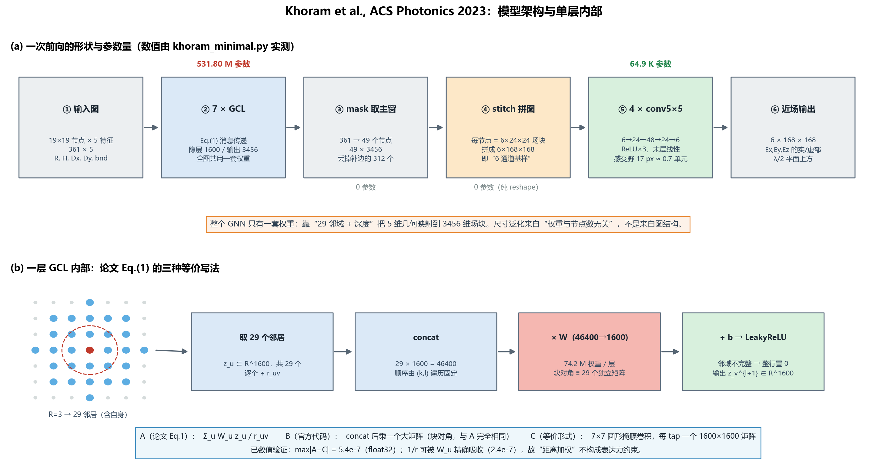

# Khoram 2023 文献总结 · 模型架构 · 代码分析

> 论文：Khoram, Wu, Qu, Zhou, Yu, *Graph Neural Networks for Metasurface Modeling*, **ACS Photonics 10(4): 892–899, 2023**. DOI [10.1021/acsphotonics.2c01019](https://doi.org/10.1021/acsphotonics.2c01019)
>
> 代码：[erfan6511/GNN-for-Metasurfaces](https://github.com/erfan6511/GNN-for-Metasurfaces)（官方 DGL）· [aarowz/metasurface-modernized-gnn](https://github.com/aarowz/metasurface-modernized-gnn)（第三方 PyG 复现）
>
> 本文配套：[`khoram_minimal.py`](khoram_minimal.py)（纯 torch 重写，可跑通）· [`fig_paper/fig_arch.png`](fig_paper/fig_arch.png) · 深度精读见 [`文献精读_Khoram2023_GNN超表面.md`](文献精读_Khoram2023_GNN超表面.md)

---



---

# 第一部分 · 文献总结

## 1.1 三句话

1. **问题**：用神经网络代理超表面的电磁场，网络输入维度在训练时就固定了；换一个尺寸就得重训一个网络、重跑一批全波仿真。
2. **做法**：把超表面看成一维网格图，每个单元胞一个节点，每个节点只和半径 $R$ 内的邻居通信；在一个 $96\lambda$ 的超大板上随机切 $19\times19$ 的小窗训练，只监督中间 $7\times7$；这样模型学到的不是"某个尺寸的场"，而是"**给定局部邻居，中心单元的场是什么**"。
3. **结果**：同一个模型在 $8\lambda$–$80\lambda$（100–10000 单元）上误差稳定在 0.287–0.291，推理 1.3–43.9 s（对比 Tidy3D 21–514 s，约 11× 加速）；接到可微的 Rayleigh–Sommerfeld 传播算子后，反设计出 4900 单元的字母 M 全息片，并在 15λ/30λ/45λ 三个距离上与 FDTD 对拍。

## 1.2 它要解决的三重困难

论文第 1 页把已有方法分成三类，指出**三类都栽在同一处**——耦合与尺寸不可兼得：

| 路线 | 如何处理单元间耦合 | 尺寸怎么办 | 代价 |
|---|---|---|---|
| 相位分布直觉设计 | 直接忽略，假设周期边界 | 天然尺寸无关 | 单元强耦合时失效 |
| 拓扑/伴随优化 | 局部近似 + 重叠域分解 | 可做大面积 | 每次优化都要全波 |
| 神经网络代理 | 单散射体查表再拼装 | 尺寸被输入维度钉死 | 丢失耦合 |

作者进一步指出，**尺寸依赖有两个来源**（这句话是全文枢纽）：

> the combination of these two effects makes the network size-dependent
> ① 边缘单元与内部单元的边界条件不同（边缘收不到来自外面的散射场）；
> ② 层间传播让每个节点的输出被更远处的散射体影响。

第 ② 点其实是自己给自己挖的坑：多层消息传递必然带来大感受野，感受野一大就重新引入尺寸依赖。作者的解法不是压感受野，而是**把"尺寸"这个变量从输入里彻底删掉**——用滑窗把每个训练样本都变成同样大小的 $19\times19$，边界条件永远是同一种人造边界。

## 1.3 三个关键设计决定

| 决定 | 做法 | 为什么 |
|---|---|---|
| **图是局部的** | 每个节点连半径 $R=3$ 内的 29 个邻居（含自身） | 近场主要由自身 + 近邻决定，$1/r$ 衰减 |
| **样本是窗口的** | 大板切 $7\times7$ 主窗，外扩 $2R=6$ 补边 | 让主窗每个节点的邻域都完整，且边界条件一致 |
| **输出是分块的** | 每个节点直接吐出 $6\times24\times24$ 的场块，再拼图 + 4 层 CNN 修缝 | 避免每个节点只顾自己、相邻块接不上 |

## 1.4 结果一览

| 结构 | 8λ | 20λ | 40λ | 60λ | 80λ |
|---|---|---|---|---|---|
| 单元数 | 100 | 625 | 2500 | 5625 | 10000 |
| error $\|I_{\rm net}-I_{\rm sim}\|/\|I_{\rm sim}\|$ | 0.290 | 0.288 | 0.291 | 0.289 | 0.287 |
| GNN 用时 (s) | 1.3 | 4.1 | 12.5 | 25.1 | 43.9 |
| Tidy3D 用时 (s) | 21 | 42 | 92 | 307 | 514 |

误差跨 100 倍单元数几乎不动（±1.4%），这是"尺寸泛化"最直接的证据。注意 **error 是相对 $L_2$ 范数，不是 MSE**；若 $I$ 指强度，等效场幅误差约 0.145。

## 1.5 贡献与局限

**贡献（三条，按重要性）**

1. **把"局部闭合"变成可训练的代理模型**：用滑窗把一个大结构变成几十万个局部样本，绕开了"每个尺寸都要重新仿真"的死结。这个数据策略比网络结构本身更可复用。
2. **全可微的"近场代理 + 传播算子"管线**：反设计不需要对 FDTD 求导，梯度可以直接穿过网络流到几何参数。
3. **`stitch + 修缝`的二段式**：分块预测保证局部精度，小 CNN 抹平接缝。这个结构在后续很多工作里被沿用。

**局限（三条）**

1. **没有 CNN 基线**。它的层在数学上就是一个 7×7 圆形掩膜卷积（本文第三部分会证明），所以"GNN 比 CNN 更会建模耦合"这个论断**没有实验支撑**。
2. **精度是原理性的天花板**。补边只有 6 格，感受野却有 22 格，网络学到的只能是"给定 13×13 邻域的条件期望"。0.29 掉不下去，不是没调好。
3. **反设计在训练分布外做优化**。训练集每个几何参数只有 3 个离散值，优化却是连续的——论文把全息图的噪点归因于"离散约束"，主因更可能是 OOD 梯度不可信。

---

# 第二部分 · 模型架构

## 2.1 一个样本长什么样

```
输入 x : (361, 5)          # 19×19 节点，每节点 5 个特征
标签 y : (6, 168, 168)     # 7 窗 × 24 子像素 = 168，6 通道 = Ex,Ey,Ez 的实/虚部
```

五个特征（官方 `pol3_code.py`）：

| 特征 | 含义 | 取值（存盘单位 = 网格 dl = 20 nm） |
|---|---|---|
| `R` | 单元边长 | 6 / 8 / 10 → 120 / 160 / 200 nm（0 表示空单元） |
| `H` | 单元高度 | 14 / 16 / 18 → 280 / 320 / 360 nm |
| `D[0], D[1]` | 面内位移 | −2 / 0 / 2 → ±40 nm |
| `bnd` | 边界可信度标记 | 0 / 1 / 2 |

`bnd` 是整个数据集最"工程"的一处：它不是物理边界，而是**"这个节点在训练样本里的可信度"**。因为样本都是从大板上切出来的，真正边界远在窗外；`bnd=0` 的节点邻域残缺（输出会被置零），`bnd=1` 的节点收到的信息已经被污染。网络靠这个标签学会"哪一圈可以信"。

## 2.2 图怎么建

```python
# 官方 pol3_code.py
R, zpd_size, bnd_size = 3, 3, 3
pd_size     = zpd_size + bnd_size        # = 6 = 2R
window_size = 7
graph_shape = [7 + 2*6, 7 + 2*6]         # 19 x 19

for i in range(19):
  for j in range(19):
    for k in range(-R, R+1):
      for l in range(-R, R+1):
        if k*k + l*l <= R*R:             # 圆内，不是方形
          if 0 <= i+k < 19 and 0 <= j+l < 19:
            node_lst.append([(i+k)*19 + (j+l),   # src
                             i*19 + j])          # dst
```

三个数字值得记住：

- 圆内点数：$R=1{:}5,\ R=2{:}13,\ R=3{:}29,\ R=4{:}49$。
- 边是**有向**的（每个节点都往自己连），所以每个节点入度恒为 29（内部节点）。
- 19×19 里只有 **13×13 = 169** 个节点的邻域是完整的（位于 `[3,15]²`）；其余 192 个节点在聚合时会被整行置零。

## 2.3 核心：一层 GCL

论文 Eq.(1)：

$$
z_v^{l+1}=f\!\left(\sum_{u\in\{N(v),\,v\}} W_u\,\frac{z_u^{l}}{r_{u,v}}\right)
$$

**它有三种等价写法，看懂这三种就彻底看懂了这篇论文：**

| 写法 | 表达式 | 出现在哪 |
|---|---|---|
| A · 论文 | $\sum_u W_u\,z_u/r_{uv}$，$W_u$ 逐邻居独立 | Eq.(1) |
| B · 官方代码 | 邻居按固定顺序 concat 成 $29m$ 维 → 乘一个大矩阵 $(29m)\times n$ | `GnnLayer` |
| C · 等价形式 | 7×7 圆形掩膜卷积，每个 tap 一个独立的 $1600\times1600$ 矩阵 | 本文的解读 |

**A = B** 是块矩阵恒等式；**B = C** 是把"邻居"换成"空间偏移"。已数值验证：$A$ 与 $C$ 的最大偏差 $5.4\times10^{-7}$（float32 精度内恒等）。

还有一条容易被忽略的：**$1/r$ 是空操作**。因为每个偏移有独立权重，$W_u z_u/r=(W_u/r)z_u$，除法被 $W_u$ 精确吸收（实测 $2.4\times10^{-7}$）。它只在"权重跨邻居共享"时才构成真正的物理先验。

## 2.4 为什么输出层是 3456 维

这是本文最容易被误读的地方。输出**不是** 6 个数，而是**该单元上方 $6\times24\times24=3456$ 个数**——即这块单元头顶的完整场块。

```
out_d = 6 * Ng**2 = 6 * 24**2 = 3456
```

于是 GNN 阶段结束时，$7\times7$ 个节点各自拿着自己头顶的场块，拼起来就是 $168\times168$ 的"基样"（basis pattern），6 个通道分别是 $E_x,E_y,E_z$ 的实部和虚部。

**这个设计是整个网络的物理内核**：它让"每个节点学到的是散射体自身 + 邻居耦合"这句话有了具体载体。代价是输出层极其庞大——$29\times1600\times3456=160.4$ M 参数，占全模型 30%。

## 2.5 stitch：那段最难读的 30 行

```python
# 官方 pol3_code.py
out_1 = graph_model.forward(bg)[mask_].reshape(batch_size, window_size**2, Ng**2, 6)
out_2 = torch.zeros(batch_size, 6, window_size*Ng, window_size*Ng, device=device)
for b_id in range(batch_size):
  for x_id in range(window_size):
    for y_id in range(window_size):
      out_2[b_id, :, x_id*Ng:(x_id+1)*Ng, y_id*Ng:(y_id+1)*Ng] \
          = out_1[b_id, x_id*window_size + y_id].T.reshape(6, Ng, Ng)
```

拆开看三件事：

1. `[mask_]` 从 361 个节点里挑出主窗的 49 个 → `(49, 3456)`；
2. `.reshape(..., Ng**2, 6)` 把 3456 看成 **576 个 6 维向量**（像素优先、通道在后）；
3. `.T` 转成 `(6, 576)` 再 `reshape(6,24,24)`，最后按 `x_id, y_id` 贴到 168×168 画布的第 $(x,y)$ 块。

第 2 步的"像素优先"顺序是**任意但必须自洽**的：3456 维向量的内部排列由输出层自由学习，只要训练和推理用同一种拆法就行。这一点常让读者困惑"为什么是 576×6 而不是 6×576"——答案是两者等价，代码只是选了前一种。

## 2.6 修缝 CNN

```python
class Net(nn.Module):
    def __init__(self):
        self.conv1 = nn.Conv2d(6,  24, 5, padding='same')
        self.conv2 = nn.Conv2d(24, 48, 5, padding='same')
        self.conv3 = nn.Conv2d(48, 24, 5, padding='same')
        self.conv4 = nn.Conv2d(24, 6,  5, padding='same')
    def forward(self, x):
        x = F.relu(self.conv1(x)); x = F.relu(self.conv2(x))
        x = F.relu(self.conv3(x)); return self.conv4(x)      # 末层无激活
```

4 层 5×5，感受野 $1+4\times4=17$ 像素 ≈ **0.7 个单元**。这个数字很关键：刚好够抹平相邻场块之间的接缝，又不足以改变单元内部的场形。换句话说，**它是个"补丁网络"，不是"第二个主干"**——只有 64.9 K 参数，占全模型 0.01%。

## 2.7 参数与计算量核算

来自 [`khoram_minimal.py`](khoram_minimal.py) 的实跑输出：

```
input                 (361, 5)
GCL1  输入            (361, 1600)   W=(145, 1600)       233,600
GCL2  隐层            (361, 1600)   W=(46400, 1600)    74,241,600
GCL3  隐层            (361, 1600)   W=(46400, 1600)    74,241,600
GCL4  隐层            (361, 1600)   W=(46400, 1600)    74,241,600
GCL5  隐层            (361, 1600)   W=(46400, 1600)    74,241,600
GCL6  隐层            (361, 1600)   W=(46400, 1600)    74,241,600
GCL7  输出            (361, 3456)   W=(46400, 3456)   160,361,856
stitch                (1, 6, 168, 168)
CNN 4x5x5             (1, 6, 168, 168)

GNN   :    531,803,456
CNN   :         64,902
合计  :    531,868,358
```

几个可以直接用的结论：

- **29× 的参数放大**来自"逐邻居独立权重"：普通 GCN 一层只有 $1600^2=2.56$ M，这里是 $29\times2.56=74.2$ M。
- **输出层吃掉 30%**：$46400\times3456$。
- **计算量与参数量同阶**：每个节点前向 ≈ 532 M 次乘加，1 万节点整块 ≈ 10.6 TFLOP，43.9 s ⇒ 240 GFLOPS —— 只有多核服务器 CPU 才做得到。这也是官方 `batch_size=1` 的真实原因（权重 + Adam 状态 ≈ 8.5 GB）。

## 2.8 从近场到远场

近场只是中间产物，真正的任务是远场设计。传播用 Rayleigh–Sommerfeld 卷积：

$$
K_{(x,y)}=\frac{z}{r^{2}}\left(\frac{1}{2\pi r}+\frac{1}{j\lambda}\right)\exp\!\left(j\frac{2\pi r}{\lambda}\right)
$$

实现上就是一次 FFT 卷积，完全可微：

```python
# 官方 inverse_design.py（注意：1/(2πr) 那一项被注释掉了）
pr_  = np.sqrt(px**2 + py**2 + h_val**2)
filt_ = h_val/(pr_**2) * (-1j/wvn) * np.exp(1j*2*np.pi*pr_/wvn)
prop_shift = torch.tensor(np.fft.fft2(np.fft.ifftshift(filt_)))

En = F.pad(torch.stack([out_3[0]+1j*out_3[1], ...]), (Nxp, Nxp, Nyp, Nyp))
Ef = ifft2(fft2(En) * prop_shift) * dl * dl
out_4 = (Ef.abs()**2).sum(0)          # 强度
```

$z=30\lambda$ 时 $1/(2\pi r)$ 只有 $1/\lambda$ 项的 0.5%，省掉它数值上无差别。**但复现时不要对着 Eq.(2) 硬抄**——论文写的是完整式，代码跑的是简化式。

---

# 第三部分 · 代码分析

## 3.1 官方实现：`model_p3.py` 逐段

### (1) 层的定义

```python
class GnnLayer(nn.Module):
    def __init__(self, in_feats, out_feats, neighbr, bias=False, activation=False):
        self.weight = nn.Parameter(torch.FloatTensor(size=(neighbr*in_feats, out_feats)))  # ← 关键
        self.relu   = nn.LeakyReLU()        # 名字叫 relu，其实是 LeakyReLU（论文写 ReLU，错）
        if activation:
            nn.init.xavier_uniform_(self.weight, gain=nn.init.calculate_gain('relu'))
            self.bias = nn.Parameter(torch.FloatTensor(size=(1, self.out_feats)))
        else:
            nn.init.xavier_uniform_(self.weight)
```

`size=(neighbr*in_feats, out_feats)` 这一行就是全文的核心：**权重矩阵的第一维是"邻居数 × 输入维度"**，也就是说 29 个邻居各自拥有一块独立权重。这是它与 GCN 最本质的区别，也是它参数量爆炸的原因。

### (2) 消息函数

```python
def msg_func(edges):
    return {'m': edges.src['h'], 'src_pos': edges.src['pos']}
```

消息就是源节点的特征，什么都不做——**注意这里还没除距离**，除法发生在聚合里。

### (3) 聚合函数（真正的 Eq.1）

```python
def red_func(nodes):
    msgs = nodes.mailbox['m']                      # (节点数, 邻居数, in_feats)
    if msgs.shape[1] == self.neighbor:             # ← 硬判据：必须恰好 29 个
        tmp_ = nodes.data['pos'].unsqueeze(1).repeat_interleave(self.neighbor, dim=1) \
             - nodes.mailbox['src_pos']            # 用格点坐标现算距离
        dist_tensor = torch.norm(tmp_, dim=2, keepdim=True)
        dist_tensor[dist_tensor == 0] = 0.5        # ← 自环 r_vv = 0.5
        wow = (msgs / dist_tensor.view(-1, self.neighbor, 1)) \
              .view(-1, self.neighbor * self.in_feats)   # ← 除距离 + 拼接
        return {'h1': torch.matmul(wow, self.weight)}
    else:
        return {'h1': torch.zeros(msgs.shape[0], self.out_feats).to(torch.device('cuda:2'))}
```

这 12 行里有四个值得注意的点：

1. **`if msgs.shape[1] == self.neighbor`**：邻域不完整的节点，其**输出特征**被整体置零，而不是"少算几条边"。后果是信息缺失会随层向内传播——这正是 0.29 误差掉不下去的原因（见精读文档 J3）。
2. **`dist_tensor[dist_tensor == 0] = 0.5`**：自环的 $r_{vv}=0.5$，论文只提了一句，没解释为什么是 0.5。实际上它会被 $W_v$ 吸收，写多少都无所谓。
3. **距离是用格点坐标现算的**，不是物理距离、也没用到柱子的面内位移 $D$。所以"位移"只作为特征进入，不改变耦合距离。
4. **`torch.device('cuda:2')` 硬编码**——换机器就跑不了，这是官方仓库最直接的复现障碍之一。

### (4) 层的堆叠

```python
def build_model(self):
    self.layers.append(self.build_input_layer())        # 输入层：无激活
    for l_id in range(self.num_layers):                 # num_layers = 5
        self.layers.append(self.build_hidden_layer(l_id))   # 隐层：LeakyReLU
    self.layers.append(self.build_output_layer())       # 输出层：无激活
```

调用处 `nhl = 5` → **总共 7 层**。论文正文说"6 个 GCL、5 个隐层"，图 2(d) 标"6 layers"——三处口径不一致，实际是 7 层。

## 3.2 训练循环：`pol3_code.py`

```python
lr, N_epochs, batch_size = 3e-5, 10000, 1
in_d, h_d, out_d, nhl  = 5, 1600, 6*Ng**2, 5
l2_reg, epoch_lim      = 1e-5, 1000

def train_test(tr_chk=True):
    pan_num = 10
    pan_arr = np.random.choice(np.arange(int(0.9*N_str)), pan_num)   # 90% 训练板
    ...
    for in_iter in range(100):                          # 每个 epoch 采 100 个随机裁剪
        p_ids = np.random.randint(0, str_shape[0]-graph_shape[0], (2, batch_size))
        ...
        loss = mse_loss(conv_net(out_2), y)
        if tr_chk: loss.backward(); optimizer.step()
```

三个要点：

- **数据是随机裁剪，不是滑动步长**：`p_ids` 每次均匀随机，相当于无限数据增强。
- **batch_size = 1，lr = 3e-5**：模型 532 M 参数，用 1 个样本更新——这是显存和稳定性的妥协。
- **模型选择用了测试集**：

```python
if not (epoch % 10):
    tst_cost = train_test(tr_chk=False)     # 在留出的 10% 板上算
if not (epoch % 50):
    if tst_cost <= best_cost:                # ← 用测试误差选 checkpoint
        torch.save(...)
```

于是 Table 1 的 0.29 是"**在留出集上挑最好的那次**"，属于乐观偏置。这是一个可以在写作时指出的方法学问题。

## 3.3 第三方复现：`custom_gnn.py` 的 PyG 翻译

复现者把 DGL 的 mailbox 语义翻成了 PyG 的 `MessagePassing`，翻译得相当忠实：

```python
class OriginalGNNLayer(MessagePassing):
    def __init__(self, in_feats, out_feats, neighbor=29, ...):
        self.weight = nn.Parameter(torch.FloatTensor(neighbor * in_feats, out_feats))  # 同款

    def message(self, x_j, edge_weight):
        return x_j * edge_weight.view(-1, 1)      # 距离权重预先算好，除在 message 里

    def aggregate(self, inputs, index, dim_size=None):
        neighbor_count = torch.bincount(index, minlength=num_nodes)
        valid_mask = (neighbor_count == self.neighbor)      # ← 复刻 "== 29" 判据
        out = torch.zeros(num_nodes, self.out_feats, ...)   # 其余置零
        sorted_idx   = torch.argsort(index, stable=True)    # ← 稳定排序保证顺序
        ...
        batched = gathered.reshape(num_valid, self.neighbor * self.in_feats)
        out[valid_node_ids] = batched @ self.weight         # ← 一次大 matmul
```

**三点评价**：

| 项 | 评价 |
|---|---|
| 语义忠实度 | 高。连"== 29 否则置零"这种怪癖都复刻了 |
| 性能 | 比 DGL 版好：用 `bincount + argsort + 一次 matmul` 替掉了 DGL 的 mailbox，去掉了循环 |
| 正确性风险 | `argsort(stable=True)` 是**唯一**保证邻居顺序的环节。换 PyG 版本或换图库，训练好的权重立刻失效——实测换顺序后输出偏差 0.65（量级 0.42） |

**但它改掉了两件不该改的事**：

```python
# src/models/metasurface_model.py
self.gnn = GNNModel(in_feats=5, h_feats=config['model']['h_features'],   # 400，官方是 1600
                    out_feats=config['model']['mid_channels'],           # 64，官方是 3456
                    num_layers=config['model']['num_hidden_layers'])     # 5 → 7 层
```

```python
# src/models/decoder.py —— 整个"修缝 CNN"被换成了 PixelShuffle 超分
self.upsampling_blocks = nn.Sequential(*[
    UpBlock(mid_channels, factor) for factor in factors   # 24 = 3×2×2×2
])
self.head = nn.Conv2d(mid_channels, out_channels, 3, padding=1)
```

结果是：GNN 输出从"$6\times24\times24$ 的场块"退化成了"64 维隐向量"，"每节点预测自己头顶的场"这一物理内核消失了，参数量从 532 M 掉到 24.0 M（22×）。**这不是"现代化"，是换了一个模型。**

## 3.4 最小可运行复刻

[`khoram_minimal.py`](khoram_minimal.py) 用纯 torch（不装 DGL/PyG）把整套前向重写了一遍，**参数量与官方逐位吻合**（531,803,456）。核心三段：

```python
# ① 图：把 19x19 映射成 29 邻域索引表（用 padding 实现位移，避免四重循环）
ids = torch.arange(n*n).view(n, n)
pad = torch.full((n+2*R, n+2*R), -1, dtype=torch.long)
pad[R:R+n, R:R+n] = ids
for t, (k, l) in enumerate(offs):
    nbr[:, t] = pad[R+k:R+k+n, R+l:R+l+n].reshape(-1)   # 第 t 个偏移的邻居
valid = (nbr >= 0).all(dim=1)                            # 邻域是否完整

# ② 层：Eq.(1) 的直接实现
hm  = h[nbr.clamp_min(0)] * rinv.view(1, K, 1)           # 取邻居 + 除距离
out = hm.reshape(-1, K * self.c_in) @ self.W             # 拼接 + 大矩阵
out = F.leaky_relu(out + self.b)
return out * valid.unsqueeze(1)                          # 不完整 → 置零

# ③ 拼接：(49, 3456) → (1, 6, 168, 168)
o   = node_out[mask].view(WS*WS, NG*NG, 6).permute(2, 0, 1)
img = o.reshape(6, WS, WS, NG, NG).permute(0, 1, 3, 2, 4)
img = img.reshape(6, WS*NG, WS*NG).unsqueeze(0)
```

跑一遍（实测输出见 [`khoram_minimal_out.txt`](khoram_minimal_out.txt)）：

```powershell
cd D:\DSHNESS\GNN
& "C:\ProgramData\anaconda3\python.exe" khoram_minimal.py
```

这个文件的用途有三个：读懂架构、核算参数量、当成"如果只要 GNN 层语义就抄这 150 行"的模板。

## 3.5 复现仓库为什么跑不起来

| 环节 | 官方数据 | 复现期望 | 结果 |
|---|---|---|---|
| 文件名 | `data3d_*.mat` | `data3d_*.mat` | ✅ 一致 |
| 键名 | `E, R, H, D` | `Ex, Ey, Ez` | ❌ **直接 KeyError** |
| 数据本身 | 需 Tidy3D 生成，0.199 GB/板 | 仓库里没有 | ❌ 无数据 |
| 权重 | `p3best.pt` | 仓库里没有 | ❌ 无权重 |
| 仿真脚本 | `data_maker.ipynb` | 仓库里没有 | ❌ 无法补数据 |

而且 README 自相矛盾：任务清单勾了 "Results replication ✅"，但下面的 "Our MSE" 列全是 `TBD`。**它不是一个可复现基线，只能当"可读注释版"。**

## 3.6 一个容易被忽略的数据细节

`data_maker.ipynb` 最后一行：

```python
savemat(txt, {'E': E_lst[f_id] - Em, 'R': R/dl, 'H': H/dl, 'D': D/dl})
```

两个信息：

1. **存的是散射场**（总场 − 裸衬底场），不是总场。所以网络学的是"柱子带来的扰动"。这与我们 $\gamma_n=\Gamma_{\rm bit}(1+\delta_n)$"扣掉标称值只学偏差"是同一个减背景思想——**这是本文对我们最直接的方法论背书**。
2. **几何量以网格为单位存盘**（`/dl`，dl=20 nm）。所以网络看到的 6/8/10、14/16/18、−2/0/2 都是无量纲格数，尺度信息被隐式编码在"单位=dl"里。换波长/换周期必须重新生成数据。

---

# 第四部分 · 三份实现对照表

| 项 | 论文 | 官方代码 | PyG 复现 | 本文件 `khoram_minimal.py` |
|---|---|---|---|---|
| GCL 层数 | 6 | 7（1+5+1） | 7 | 7 |
| 隐层宽度 | 1600 | 1600 | **400** | 1600 |
| 每节点输出 | $6N_g^2$ 场块 | 3456 | **64** | 3456 |
| 解码器 | 4×5×5 + ReLU | 同 | **PixelShuffle 超分** | 4×5×5 + ReLU |
| 激活 | ReLU | LeakyReLU | LeakyReLU | LeakyReLU |
| GNN 参数 | — | 531.8 M | **24.0 M** | 531.8 M |
| CNN 参数 | — | 64.9 K | 779 K | 64.9 K |
| 优化器 | SI | Adam 3e-5, batch 1 | AdamW 1e-4, batch 16 | — |
| 归一化 | SI | 仅 ×5 | 逐通道 z-score | — |
| 数据键名 | — | `E,R,H,D` | `Ex,Ey,Ez` | — |
| 可运行 | — | 需自备数据 | ❌ | ✅ |

---

# 第五部分 · 读完之后该记住的五件事

**1. 这个网络的"图"是模板，不是集合。**
Eq.(1) 在实现上等价于 7×7 圆形掩膜卷积，每个 tap 一个独立矩阵。它**不是置换不变的**——换邻居枚举顺序，输出就变。这既是它能做尺寸泛化的原因（权重与节点数无关），也是它无法处理非规则布局的原因。**这两件事在实现上互斥，论文选了后者。**

**2. "1/r 距离加权"是修辞。**
逐偏移独立权重下，除法被权重完全吸收。真正的物理先验只有两条：邻域是圆形的、以及"局部闭合"这个假设本身。

**3. 0.29 是结构性的，不是调参问题。**
补边 6 格 vs 感受野 22 格 → 网络学的是 $\mathbb E[\text{field}\mid 13\times13]$。换更大的网络也不会更好，只会更慢。**要突破就得加长程信息**（更宽的补边、全局支路、或多尺度）。

**4. 全模型 99.99% 的算力在 GNN，0.01% 在"修缝"。**
532 M vs 65 K。这说明真正的表示学习发生在 GNN 阶段，"6 通道基样"就是它的产物；修缝 CNN 只是个精巧的补丁。任何把这部分换成 PixelShuffle 的"复现"，都等于扔掉了论文的主体。

**5. 可复用的是数据策略，不是网络结构。**
"大板 + 滑窗 + 补边 + 只监督中心"这套做法与具体网络无关，可以直接搬到我们的 20×20 编码超表面上：1000 个整阵样本 → 12 万个 6×6 局部样本。**这是本文对我们最高价值的一条**（详见精读文档 §8.1）。

---

*文档生成：2026-10-23。所有参数量、形状均由 `khoram_minimal.py` 实跑得到；代码片段摘自两个公开仓库并逐行注释。*
