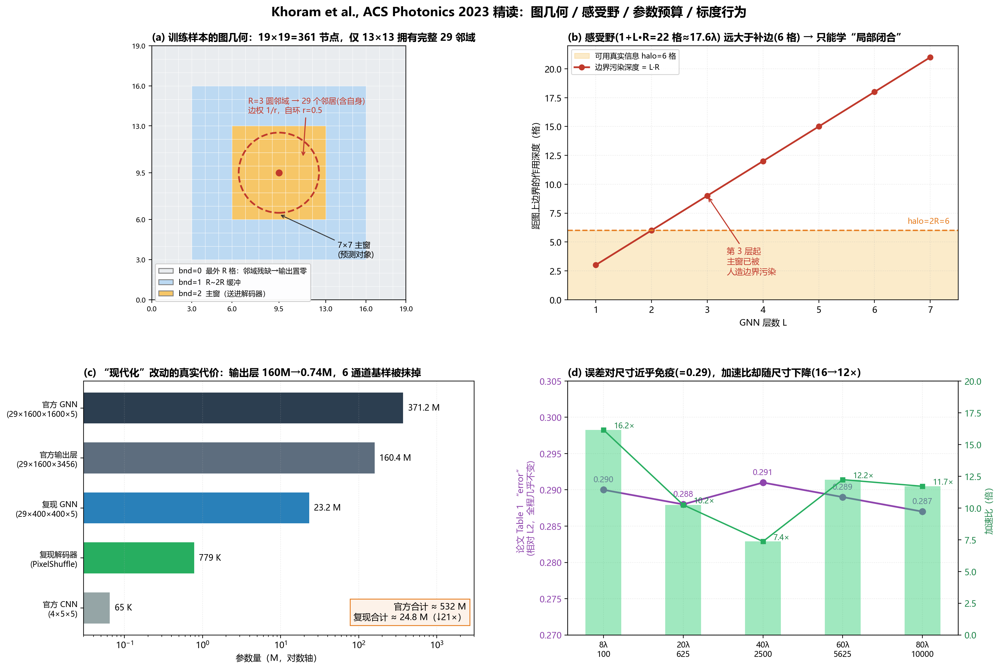

# 文献精读：Khoram et al., *Graph Neural Networks for Metasurface Modeling*

> **论文**：Erfan Khoram, Zhicheng Wu, Yurui Qu, Ming Zhou, Zongfu Yu, *Graph Neural Networks for Metasurface Modeling*, **ACS Photonics 10(4): 892–899, 2023**. DOI [10.1021/acsphotonics.2c01019](https://doi.org/10.1021/acsphotonics.2c01019)。威斯康星大学麦迪逊分校（Zongfu Yu 组）。收稿 2022-06-30，上线 2022-11-23。
>
> **本地 PDF**：`D:\ai\文档\GNN\1.pdf`（8 页，含正文全部公式与图表）。
>
> **代码**：
> - 官方实现（DGL）：[erfan6511/GNN-for-Metasurfaces](https://github.com/erfan6511/GNN-for-Metasurfaces)
> - "现代化"复现（PyG）：[aarowz/metasurface-modernized-gnn](https://github.com/aarowz/metasurface-modernized-gnn)
>
> **本篇的核对方法**：PDF 用 PyMuPDF 抽全文（`文献/1_pymupdf.txt`）并逐条对照公式截图；三个仓库的全部 `.py` 逐个读过；对关键论断另写数值脚本 `verify_khoram_equiv.py` 做了 5 项可执行核验（报告见 `verify_khoram_report.txt`）。凡是我自己的推断而非论文/代码明写的，都标了 **`推断`**。

---

## 目录

- [0 一页纸结论](#0-一页纸结论)
- [1 问题：为什么"任意尺寸"这么难](#1-问题为什么任意尺寸这么难)
- [2 方法逐层拆解](#2-方法逐层拆解)
- [3 结果：能读出什么，不能读出什么](#3-结果能读出什么不能读出什么)
- [4 代码精读：三份实现的逐项对照](#4-代码精读三份实现的逐项对照)
- [5 论文—代码不一致清单（14 条）](#5-论文代码不一致清单14-条)
- [6 五个关键判断](#6-五个关键判断)
- [7 可攻击点：审稿人会问什么](#7-可攻击点审稿人会问什么)
- [8 对我们项目的用法](#8-对我们项目的用法)
- [9 复现成本估算](#9-复现成本估算)
- [10 待确认清单](#10-待确认清单)
- [附录 A 符号与公式](#附录-a-符号与公式)
- [附录 B 本地可复现的核验](#附录-b-本地可复现的核验)

---

## 0 一页纸结论



**一句话**：这篇论文真正做成的事，是"**用一个大结构的滑窗切片，训练一个局部的、平移等变的算子，从而让模型只见过 96λ 的板子、却能推理 8λ–80λ 任意尺寸**"；它并没有做成"图神经网络比 CNN 更会建模耦合"这件事——后者是论文的叙事，不是论文的证据。

五条要点（前三条已用数值验证，后两条是高置信推断）：

1. **所谓 GNN 层，在实现上就是一个 7×7 圆形掩膜的卷积层。** 论文 Eq.(1) 的"每个邻居一个独立权重矩阵 + 定序拼接"与 `conv2d(kernel=7×7, 只保留圆内 29 个 tap, 每个 tap 一个独立 $C_{in}\to C_{out}$ 矩阵)` **数值恒等**（实测最大偏差 $5.4\times10^{-7}$，float32 精度内）。它**不是**置换不变的：同一套权重、只把邻居枚举顺序换一下，输出平均偏差 0.65、最大 3.16（输出量级 0.42）。

2. **"距离加权 1/r"是数学上的空操作。** 因为每个偏移有独立权重矩阵，$W_u z_u/r_{u,v} = (W_u/r_{u,v})z_u$，1/r 可被 $W_u$ **精确吸收**（实测 $\max|\Delta| = 2.4\times10^{-7}$）。它不改变可达函数集合，只改变初始化尺度。论文把它当作"物理先验"写进"Physics Preserved"，这是过度解读。

3. **0.29 的误差不是没调好，是"局部闭合"的信息论地板。** 网络 7 层 × R=3 → 感受野半径 22 格（≈17.6λ）；但输入只给了主窗外加 **6 格**（2R）的真实信息，即整张 13×13 的图。第 3 层起，主窗就已经被人造边界"污染"（图 b）。所以无论把网络练多久，它学到的都只能是 $\mathbb{E}[\text{field}\mid 13\times13\ \text{patch}]$。这正好解释了 Table 1 里误差对尺寸**近乎免疫**（0.287–0.291）——残差由闭合误差主导，与尺寸无关。

4. **"现代化"复现改掉了论文最核心的表示。** 官方代码里，每个节点直接回归 $6N_g^2=3456$ 维、即该单元上方 $6\times24\times24$ 的场块，再拼成 168×168，由 4 层 5×5 CNN 修接缝——这就是论文说的"6 通道基样"。复现仓库把输出压成 **64 维隐向量**（7×7），接一个 PixelShuffle 超分解码器。参数量从 532 M 掉到 24.8 M（↓21×），但"每单元一个场块 + 修缝"这一结构**整个消失了**。README 的 "Physics Preserved ✅" 在这一条上不成立。

5. **复现仓库跑不起来。** 无数据、无权重、无仿真脚本；数据键名与官方 `.mat` 不兼容（官方 `E/R/H/D`，复现期望 `Ex/Ey/Ez`）；README 的 "Results replication [x]" 与 "Our MSE = TBD" 自相矛盾。**不要引用它的任何性能数字**。

**对复现仓库的用途定位**：把它当"论文的可读注释版"可以，当"可复现基线"不行。

---

## 1 问题：为什么"任意尺寸"这么难

论文的立论很干净，值得照抄进自己的引言。它把已有方法分三类，并指出三类都栽在同一处：

| 类别 | 代表 | 处理耦合的方式 | 尺寸泛化 |
|---|---|---|---|
| 相位分布直觉设计 | 超透镜相位公式 | 完全忽略，假设周期边界 | 靠"拼装"，尺寸无关但精度差 |
| 拓扑/伴随优化 | Pestourie 2018、Lin & Johnson 2019 | 局部近似 + **重叠域**分解 | 可做大面积，但每次优化都要全波 |
| 神经网络代理 | Liu 2018、Zhelyeznyakov 2021 等 | 单散射体查表 | **尺寸被输入维度钉死** |

作者的论证链（第 1 页）：

1. 若网络只看单个散射体 → 丢失单元间耦合 → 只能"拼装"。
2. 若网络看整块超表面 → 耦合保住了，但**每换一个尺寸就要重训一个网络**，而每个网络都要一批全波数据。
3. 于是：**尺寸泛化 = 需要一个"局部"的、但与尺寸无关的表示**。

**关键洞察（论文写得不够显眼，但这是全文的枢纽）**：尺寸依赖性的根源有二，作者明确点出——

> the combination of these two effects makes the network size-dependent
> ① 边缘单元与内部单元的边界条件不同（边缘收不到来自外面的散射场）；
> ② 层间传播让每个节点的输出被更远处的散射体影响。

第 ② 点是自己给自己挖的坑：既然"多层传播 = 大感受野"，那感受野一大，就必然重新引入尺寸依赖。作者的解法不是压感受野，而是**用滑窗把"尺寸"从输入里彻底删掉**：

> 在 96λ 的大板上随机切 19×19 的小窗，只预测中间 7×7；边缘单元靠 **外扩 R 格** 补齐邻域；这样每个样本的"边界条件"都是同一种人造边界，模型学到的就只是"给定 13×13 邻居，中间 7×7 的场是什么"。

这个思路与拓扑优化里的 **overlapping domains**（文献 [9]，Lin & Johnson 2019）是同一招，只是把"优化时的局部子问题"换成了"训练时的局部样本"。论文引了 [9] 但**没有在方法上把这条线连起来**——这是一处可以替它补上的学理脉络。**`推断`**

---

## 2 方法逐层拆解

### 2.1 图怎么建

| 要素 | 设定 | 备注 |
|---|---|---|
| 节点 | 一个单元胞一个节点 | 规则方格，节点位置 = 格点坐标 |
| 边 | 半径 $R$ 的**圆邻域**（含自身） | $R=3$（实现），$R=1,2$（图示） |
| 邻域规模 | $R=1{:}5,\ R=2{:}13,\ R=3{:}29,\ R=4{:}49$ | 已核验，$R=3$ 恰为 29 |
| 节点特征 | $\mathbf{Z}^0=[w,h,d_x,d_y,b,p]$（论文） | 代码实为 5 维 $[R,H,d_x,d_y,\text{bnd}]$，$p$ 作为独立 `pos` 张量另传 |
| 边权 | $1/r_{u,v}$，$r_{v,v}=0.5$ | 格点距离，非物理距离 |

论文对 $b,p$ 只写了一句"nongeometrical features that will be explained later"，然后**只解释了 $p$，$b$ 从头到尾没解释**。对照官方代码可以确定 $b\equiv$ `bnd`（取值 0/1/2 的边界标记）。这是一处实打实的写作漏洞。**`高置信推断`**

`bnd` 的定义（官方与复现完全一致）：

```
bnd = 2                           # 默认 2 → 主窗 7×7（rows/cols 6..12）
bnd[:R, :] = bnd[-R:, :] = 0      # 最外 R 圈 → 0
bnd[:, :R] = bnd[:, -R:] = 0
bnd[R:2R, R:-R] = 1               # R~2R 的环 → 1（四条边各 3 行/列）
bnd[-2R:-R, R:-R] = 1
bnd[R:-R, R:2R] = 1
bnd[R:-R, -2R:-R] = 1
```

即：`[3,15]²` 这 13×13 的环带里，中间 7×7 标 2、外圈 3 层标 1；再外面（19×19 的最外 3 圈）标 0。

注意它的语义：**不是"物理边界"，而是"这个节点在训练样本里的可信度"**。因为每个样本都是从大板里切出来的，真正的物理边界远在窗外；`bnd=0` 的节点邻域残缺（会被置零），`bnd=1` 的节点收到的信息已经被污染。把这个标签喂给网络，等于告诉它"哪一圈可以信、哪一圈别信"。这是全文最"工程"、也最容易被审稿人挑的一处设计。

### 2.2 消息传递：Eq.(1)

$$
z_v^{l+1}=f\!\left(\sum_{u\in\{N(v),\,v\}} W_u\,\frac{z_u^{l}}{r_{u,v}}\right)
\tag{1}
$$

三个设计选择，逐个说：

**(a) $W_u$ 逐邻居独立。** 这是与 GCN/GAT 最本质的区别：不是"共享一个 $W$ 再聚合"，而是"每个空间偏移有自己的 $W$"。官方实现把 29 个邻居按固定顺序拼成 $29m$ 维向量，再乘一个 $(29m)\times n$ 的大矩阵——这与"29 个独立矩阵分别作用再求和"在代数上完全等价（块矩阵）。**代价**：参数量按 $29\times$ 放大，且**没有置换不变性**。

**(b) 先除 $r$，再乘 $W$。** 论文的物理解释是"场幅随距离衰减"。但在 (a) 的前提下，这个解释站不住：$W_u z_u/r_{u,v}=(W_u/r_{u,v})z_u$，$W_u$ 自由，除法被完全吸收。它只在**权重要跨邻居共享**时才构成真正的先验。已数值验证（附录 B / V3）。

**(c) 自环 $r_{v,v}=0.5$，且自环也参与同一个求和。** 物理上对应"自身贡献最大"，但 0.5 这个数的来源论文没给。它同样被 $W_v$ 吸收。

**所以 Eq.(1) 去掉修辞后就是**：

$$
z_v^{l+1}=f\!\left(\sum_{\delta\in\mathcal{S}_R} K_\delta\, z_{v+\delta}^{l}\right),\qquad \mathcal{S}_R=\{\delta: \|\delta\|_2\le R\}\ \text{（含 }\delta=0\text{）}
\tag{1'}
$$

即**核大小为 $(2R+1)\times(2R+1)$、掩膜为圆、每个 tap 一个独立矩阵的卷积**。$K_\delta$ 就是卷积核在偏移 $\delta$ 处的矩阵。附录 V2 给出 float32 下 $5.4\times10^{-7}$ 的数值吻合。

这不是贬低——**恰恰是论文能用它的原因**：正因为它是局部平移等变算子，才能"训练 96λ、推理 80λ"。但它也说明：**论文第 3 页那段"GNN 比 CNN 更会表达相互作用范围"的论证是修辞而非机制**。CNN 只要把核掩成圆形、并且每个 tap 给独立权重，就是同一个算子；反过来，真正的图方法（变长邻域 + 置换不变聚合）反而**不能**直接享受这种"训练窗口→任意尺寸"的迁移，因为它的权重不再绑定到空间偏移。

这是一个很有意思的悖论：**这篇论文的"图"性质，和它的"尺寸泛化"性质，在实现上是互斥的**。它选了后者。

### 2.3 两阶段：GNN 出"基样"，CNN 修缝

论文的原始设计（官方代码逐字对应）：

```
输入 19×19×5
  └─ 7 层 GCL（1 输入 + 5 隐 + 1 输出），宽度 1600
       └─ 每个节点输出 6·Ng² = 3456 维 = 该单元上方 (6, 24, 24) 的场块
            └─ 按单元位置拼成 (6, 168, 168)  ← "基样/basis pattern"
                 └─ 4 层 5×5 conv：6→24→48→24→6，前三层 ReLU，末层线性
                      └─ (6, 168, 168) 近场
```

**为什么要第二段？** 论文给的理由很实在：

> if we were to do so, each node would try to produce only the field above itself with little context of its role as part of a larger picture. This leads to the generation of small, yet noticeable seams on the borders of the unit-cells.

即：每个节点独立预测自己头顶那块 24×24 的场 → 相邻块之间不连续 → 出现"接缝"。4 层 5×5 卷积的感受野是 $17\times17$ 像素（$1+4\times4$），约 0.7 个单元——刚好够把接缝抹平，又不足以改变单元内部的场形。

**这个"先分块预测、再小网络修缝"的结构，是本文最容易被忽略的贡献**，也是复现仓库丢掉的东西（见 §4）。

### 2.4 数据策略：这才是全文最关键的工程

| 项 | 设定 | 来源 |
|---|---|---|
| 训练结构 | TiO₂ 柱 / SiO₂ 衬底，**120×120 = 14400** 单元 | `data_maker.ipynb`：`N = 120` |
| 单元几何 | 边长 120–200 nm、高 280–360 nm、面内位移 ±40 nm | 论文 + notebook |
| 周期 $a$ | **480 nm = 0.8λ**（$\lambda=600$ nm） | notebook：`S = 480 * nm` |
| 网格 | $\lambda/30 = 20$ nm → $N_g = 480/20 = 24$ 子像素/单元 | notebook：`grids_per_wavelength = 30` |
| 场平面 | 柱顶上方 $\lambda/2$，$2880\times2880$ 像素 | notebook：`center_z + H + wavelength/2` |
| 激励 | y 偏振平面波，高斯脉冲 | notebook：`polarization='y'` |
| 采样 | 19×19 窗在 120×120 上滑，stride 4 | 复现代码；官方为随机采样 |
| 单样本 | 输入 19×19×5 → 输出 6×168×168 | 数值 |

**四个从 `data_maker.ipynb` 里挖出来、论文完全没写的事实**（这几条比论文正文更影响复现）：

**(i) 存下来的是"散射场"，不是总场。**

```python
savemat(txt, {'E': E_lst[f_id] - Em, 'R': ..., 'H': ..., 'D': ...})
```

`Em` 是**只有衬底、没有柱子**时的场。所以网络学的是 $\mathbf E_{\rm total}-\mathbf E_{\rm substrate}$，即"柱子引入的扰动"。这与我们 $\gamma_n=\Gamma_{\rm bit}(1+\delta_n)$ 里"减去标称值、只学偏差"是**同一个思路**。论文正文对此只字未提。

**(ii) 空单元 ≈ 25%。** `rad_mat = choice([6,8,10,12])`，然后把 12 映射成 0（空）。所以训练集里每四个单元就有一个是空的，且空单元的 $H,D$ 也置 0。这解释了为什么图 1 里的椭圆结构能带"空洞"。

**(iii) 几何量全部以网格为单位存盘**：`R/dl, H/dl, D/dl`（dl=20 nm）。所以网络看到的 $[6,8,10]$、$[14,16,18]$、$[-2,0,2]$ 都是无量纲格数——**尺度被隐式编码在"单位=dl"里**，而不是作为特征输入。这也意味着换波长/换周期必须重新生成数据。

**(iv) 一共生成了 250 块板**，Tidy3D 自己报的"monitor 数据量 0.1991 GB/板"与我的独立估算完全一致（见 §9）。250 板全存是 50 GB。

几个可以自己核出来的数：

- **$a=0.8\lambda$ 的铁证**：notebook 里 `S = 480 * nm`，而 $\lambda=600$ nm。再交叉验证 Table 1：`8λ/100`、`20λ/625`、`40λ/2500`、`60λ/5625`、`80λ/10000` —— 全部严格满足 `长度 = 0.8λ × √单元数`。于是 $120\times0.8\lambda=96\lambda$，而论文写 **98λ**。**论文内部有 2% 的不自洽**，98λ 应为 96λ。不影响结论，但复现时必须以 $a=480$ nm 为准。
- **滑窗样本量**：$(120-19+1)^2=10404$ 个位置；stride 4 → $26^2=676$/板。论文说"hundreds of thousands of pairs"，需要 ~150 个重叠采样位置或多板堆叠。
- **单个训练样本的输出**：$6\times168\times168=169{,}344$ 个 float，即 0.68 MB/sample。这就是"端到端回归场"的数据代价。

### 2.5 近场 → 远场：可微管线

第二段用 **Rayleigh–Sommerfeld 衍射**，写成卷积：

$$
K_{(x,y)}=\frac{z}{r^{2}}\left(\frac{1}{2\pi r}+\frac{1}{j\lambda}\right)\exp\!\left(j\frac{2\pi r}{\lambda}\right),\qquad r=\sqrt{x^2+y^2+z^2}
\tag{2}
$$

官方 `inverse_design.py` 里 **把 $1/(2\pi r)$ 那一项注释掉了**，只用 $-j/\lambda$ 项（近轴/Fresnel 近似）。$z=30\lambda$ 时 $1/(2\pi r)$ 只有 $1/\lambda$ 项的 $1/(2\pi\cdot30)\approx0.5\%$，所以数值上无差别——但这说明**论文 Eq.(2) 写的是完整式，代码跑的是简化式**，复现时不要对着公式硬抄。

设计损失：

$$
\text{Loss}=\left(\frac{\int_M I(\mathbf r)\,\mathrm d\mathbf r}{\int I(\mathbf r)\,\mathrm d\mathbf r}-1\right)^{2}
+0.01\left(\int_M\big(I(\mathbf r)-I_{\rm avg}\big)\,\mathrm d\mathbf r\right)^{2}
\tag{3}
$$

第一项：目标区域**占总能量的比例**趋近 1（等价于最大化效率）；第二项：目标区域内**均匀性**。

**但 Eq.(3) 的写法是数学上退化的**：论文说 $I_{\rm avg}$ 是"同一区域的强度平均值"，即 $I_{\rm avg}=\frac{1}{A_M}\int_M I\,\mathrm dr$。代进去：

$$\int_M\big(I(\mathbf r)-I_{\rm avg}\big)\,\mathrm dr=\int_M I\,\mathrm dr-A_M\cdot\frac{1}{A_M}\int_M I\,\mathrm dr\equiv 0$$

**第二项恒等于零**。官方代码写的是方差 `((out_4[mask]-out_4[mask].mean())**2).sum()/mask.sum()`，那才是作者的真实意图——论文把"离差的平方积分"漏写成了"离差的积分"。**按论文公式实现，等于没有第二项。**

### 2.6 反设计的实际做法（论文没细说，代码里能读出来）

```python
rad_  ∈ {6, 8, 10}        # 单元边长，单位 dl=20nm → 120/160/200 nm（变量名 rad 是误导，实为边长）
hts_  ∈ {14, 16, 18}      # 单元高度，单位 dl → 280/320/360 nm
dsp_  ∈ {-2, 0, 2}        # 面内位移，单位 dl → ±40 nm
x_.requires_grad = True
lr_x = 1e4                 # 设计变量的步长（对比训练学习率 3e-5）
for iter_ in range(500):
    loss.backward()
    x_[:, :-1] -= lr_x * x_.grad[:, :-1]        # 只更新几何，不更新 bnd
    x_ = clamp(x_, 上下界)                        # 只夹范围，不夹离散
    x_[mask_bnd, :-1] = 0                         # 边界节点锁死
```

**三个要点**：

1. 优化变量是**连续的**，只在最后才量化到 FDTD 网格整数倍 → 论文自己承认的"noisy hologram"根源在此。
2. 训练集只有 3 个离散取值/参数，优化却在整个连续区间游走 → **典型的分布外优化**。论文把瑕疵归因于"离散约束"，其实更主要的原因是**代理模型在 OOD 区的梯度不可信**。
3. 边界节点被锁死为 0（空单元）→ 设计区是 70×70=4900，图是 82×82=6724。这与论文说的 "4900 scatterers" 一致。

---

## 3 结果：能读出什么，不能读出什么

### 3.1 Table 1 逐项复核

| | Str1 | Str2 | Str3 | Str4 | Str5 |
|---|---|---|---|---|---|
| 边长 | 8λ | 20λ | 40λ | 60λ | 80λ |
| 单元数 | 100 | 625 | 2500 | 5625 | 10000 |
| **error** | 0.290 | 0.288 | 0.291 | 0.289 | 0.287 |
| GNN 用时 (s, CPU) | 1.3 | 4.1 | 12.5 | 25.1 | 43.9 |
| Tidy3D 用时 (s) | 21 | 42 | 92 | 307 | 514 |
| **加速比** | 16.2× | 10.2× | 7.4× | 12.2× | 11.7× |

**读法一：error 的定义必须先搞清楚。** 论文原文（Fig. 5 下方）：

$$\text{error}=\frac{\|I_{\rm net}-I_{\rm sim}\|}{\|I_{\rm sim}\|}$$

是**相对 $L_2$ 范数**，不是 MSE。而且用的是 $I$——按 Eq.(3) 的记号，$I$ 是**强度**（$|E|^2$），不是场。如果确实是强度：

- 强度相对误差 0.29 ⇒ 场幅相对误差约 $0.29/2\approx 0.145$（小扰动下 $\delta I\approx 2|E|\,\delta E$）。这与"视觉上高度吻合"是自洽的。
- **但论文从未说明 $I$ 在场域还是强度域**，这是复现时最容易搞错的一处，**`待确认`**。

**读法二：误差对尺寸近乎免疫，这本身是最重要的结果。** 0.287–0.291，跨 100× 的单元数变化仅 ±1.4%。两种解释：

- (a) **好消息**：方法真的 size-agnostic。
- (b) **更可能的解释**：误差由"局部闭合误差"主导，与尺寸无关（§6-J3）。两者都能解释这张表，**论文没有做能区分它们的实验**。

**读法三：加速比约一个数量级，且不随尺寸改善。** 16.2→11.7，中间还掉到 7.4，噪声明显。摘要说 "near-fields ... can be obtained in seconds"，80λ 时是 43.9 s，勉强算"几十秒"。摘要又说 "significantly faster"——11× 是"显著"，但离"降维打击"还差一个量级。**做文献综述时不要写成"快几个数量级"。**

**读法四：用时数据反过来可以验证参数量。** GNN 用时随单元数近似线性（100→10000，33.8×）。按官方 532 M 参数测算，每个节点约 532 M 次乘加，10000 节点整块前向 ≈ **10.6 TFLOP**；43.9 s ⇒ **~240 GFLOPS**，只有多核服务器 CPU 才做得到。**这说明官方确实跑的是那个 532 M 的模型**，不是简化版；也说明"CPU 上几秒"这句话背后是一台大机器。

### 3.2 图 4（单结构泛化）：证据强度中等

7×7 随机结构、四周 PML、x/y 双偏振。用 90° 旋转 + 分量重排 $(E_x,E_y,E_z)=(e_y^R,-e_x^R,e_z^R)$ 把单偏振模型扩到双偏振——**这一招很实用，值得抄**：

> 训练只用 y 偏振，但要 x 偏振时，把结构旋转 90°，网络输出 $(e_x,e_y,e_z)$，再按上式还原。

**局限**：这是**分布外**测试（训练集的边界都是"从大板切出来的"，这里是真 PML 边界）。作者用它证明鲁棒性，是加分的；但只给了一个样本、无误差数字，证据强度只能算"定性"。

### 3.3 图 5（全息反设计）：最能打的部分，但缺一个数字

- 4900 个散射体，目标字母 M，$d=30\lambda$。
- 15λ / 30λ / 45λ 三个距离都比对了，字母**只在 30λ 清晰**——这是很强的物理自洽性证据（说明优化确实锁定了传播距离）。
- 三分量对比显示 $E_y$ 主导、$E_z$ 次之、$E_x$ 最弱 → 反过来说明 $E_x$ 的误差对结果影响小，**这是对 §3.1"误差 0.29 也能用"的一个辩护**。

**缺的关键数字**：代理模型 vs FDTD 在**设计点**上的定量差距（比如图案对比度、效率、相关系数）。整篇论文的卖点是"可微管线能设计出真能用的器件"，而"设计 → 复核"的定量误差恰恰没报。这是审稿人一定会问的。

---

## 4 代码精读：三份实现的逐项对照

### 4.1 三份实现的关系

```
论文文字（8 页，公式 3 个，超参大半在 SI）
   │
   ├── erfan6511/GNN-for-Metasurfaces     ← 作者官方，DGL，可跑（需自备 data3d_*.mat）
   │      training/model_p3.py             GnnLayer / Model
   │      training/pol3_code.py            训练循环 + CNN
   │      inverse_design/inverse_design.py 反设计 + RS 传播
   │      dataset/data_maker.ipynb         Tidy3D 数据生成
   │
   └── aarowz/metasurface-modernized-gnn  ← 第三方复现，PyG，8 个 .py，无数据无权重
          src/models/custom_gnn.py         OriginalGNNLayer（复刻 DGL 语义）
          src/models/metasurface_model.py  GNN + Decoder
          src/models/decoder.py            PixelShuffle 解码器
          src/data/dataset.py              滑窗数据集
          src/training/train.py            训练
          src/scripts/evaluate_model.py    评估
```

### 4.2 逐项对照表

| 项 | 论文文字 | 官方代码 | 复现仓库 | 差异性质 |
|---|---|---|---|---|
| **GCL 层数** | 6（"5 个隐层"） | **7**（1 输入 + 5 隐 + 1 输出） | **7**（`num_hidden_layers: 5` → +2） | 论文口径含糊；复现 README 写 6，与自身代码不符 |
| **隐层宽度** | 1600 | 1600 | **400** | ↓16× 表达力，复现未声明 |
| **GNN 输出** | 每单元 $6N_g^2$ 场块（6 通道基样） | `out_d = 6*24² = 3456` | **`mid_channels = 64`** | **本质差异** |
| **解码器** | 4 层 5×5 conv + ReLU | 4 层 5×5（6→24→48→24→6） | PixelShuffle(3,2,2,2) + SELU + 3×3 head | **本质差异** |
| 激活函数 | ReLU | **LeakyReLU** | LeakyReLU | 论文写错 |
| 节点特征 | $[w,h,d_x,d_y,b,p]\in\mathbb R^6$ | 5 维 $[R,H,d_x,d_y,\text{bnd}]$ + 独立 `pos` | 同官方 | 论文的 6 = 5 + pos |
| 边权 | $1/r_{u,v}$，$r_{v,v}=0.5$ | 格点距离，`dist==0 → 0.5` | 同官方 | 一致 |
| 优化器 | 未说明 | Adam, lr **3e-5**, wd 1e-5, batch **1** | **AdamW, lr 1e-4, wd 1e-5, batch 16** | 训练协议不同 |
| 训练量 | 未说明 | 1000 epoch × 100 iter（batch=1） | 200 epoch（batch=16） | 更新次数其实同量级（~10⁵），但 batch 16 vs 1 + lr 差 3.3 倍 |
| 数据划分 | 未说明 | **9:1** 两部分（`0.9*N_str`） | **7:1.5:1.5** 三部分 | 复现多了一个验证集 |
| 归一化 | 未说明 | 只乘 `E_scale=5` | **逐通道 z-score（输入/输出都做）** | 改变了各通道在损失里的权重 |
| 数据键名 | 未说明 | `E(3,N_gN,N_gN), R, H, D` | **`Ex, Ey, Ez`** | **复现读不了官方数据** |
| 数据/权重 | "code is available" | 仅代码 | 无数据、无权重、无仿真脚本 | 复现不可端到端运行 |
| 指标 | $\|I_{\rm net}-I_{\rm sim}\|/\|I_{\rm sim}\|$ | — | README 称 "MSE 0.29" | **指标误标** |
| $R$ 的图示 | 图 2(a) $R=1$、图 2(d) $R=2$、正文实现 $R=3$ | 3 | 3 | 图注与实现不一致 |

### 4.3 复现仓库的四处实现细节（真读代码才看得见）

**(a) `aggregate` 的"29 个邻居"是硬判据。**

```python
neighbor_count = torch.bincount(index, minlength=num_nodes)
valid_mask = (neighbor_count == self.neighbor)   # 必须恰好 29
out = torch.zeros(...)                            # 其余一律置零
```

这与官方 DGL 版的 `if msgs.shape[1] == self.neighbor:` 完全同构（连"否则返回零"都一样）。**语义**：邻域不完整的节点，其**输出特征**被强制为 0，而不是"少算几条边"。后果是**信息缺失会随层内向传播**（图 b）。复现者在 docstring 里诚实标注了这一点，但还是照抄了——这是"复刻语义"而非"改进"。

**(b) 邻居顺序的稳定性依赖 `argsort(stable=True)`。** PyG 的 `edge_index` 是 `[E,2]` 拼接后的顺序，聚合前按目标节点稳定排序，从而保证每个节点的消息顺序 = 建边时的 `(k,l)` 遍历顺序。**这条链一旦断（换 PyG 版本、换 `sort` 实现、换图库），训练好的权重就失效**——V4 实测偏差 0.65（输出量级 0.42），不是小量。

**(c) 归一化把"空单元"的语义毁了。** 输入 4 个几何通道做了 z-score，空单元（`R=H=Dx=Dy=0`）归一化后变成一个**非零的负向量**；网络再也没法从"全 0"直接认出空单元。论文里"An empty unit-cell sets these four parameters to zero"这个漂亮的设计，在复现版里被归一化抹掉了。`推断`：这会损失一些精度。

**(d) 解码器其实有 5 个卷积层**（4 个 UpBlock 各 1 个 3×3 + 1 个 head 3×3），不是论文的"4 层 5×5"，也不是 README 的"4 层"。README 里 "CNN Stage: 4 convolutional layers for field refinement" 是**照着论文抄的**，不是照着代码写的。

### 4.4 复现仓库的正确用法

| 用法 | 可行性 | 说明 |
|---|---|---|
| 当论文的"可读注释版" | ✅ 推荐 | `custom_gnn.py` 把 DGL 的 mailbox 语义翻译成 PyG，注释清楚，是理解 Eq.(1) 的最好材料 |
| 当"可复现基线" | ❌ | 无数据、无权重、数据格式不兼容 |
| 引用它的性能数字 | ❌ | 全是 TBD；README 的 0.29 是从论文 Table 1 抄来的，不是自己跑出来的 |
| 引用它的架构描述 | ⚠️ | 层数、宽度、解码器都与论文不符 |

---

## 5 论文—代码不一致清单（14 条）

按"会不会坑到复现者"排序：

| # | 问题 | 证据 | 后果 |
|---|---|---|---|
| 1 | 6 通道基样 vs 64 维隐向量 | 官方 `out_d=6*Ng²`；复现 `mid_channels=64` | 复现版不是同一个模型 |
| 2 | 解码器语义完全不同 | 官方 4×5×5 conv；复现 PixelShuffle 超分 | "修缝"机制消失 |
| 3 | 数据键名不兼容 | 官方 `E/R/H/D`；复现 `Ex/Ey/Ez` | 复现版读不了官方数据 |
| 4 | 指标误标为 MSE | 论文 $\|I_{\rm net}-I_{\rm sim}\|/\|I_{\rm sim}\|$；README "Target MSE" | 会被引用成错误数字 |
| 5 | 层数 6 vs 7 | 官方 `nhl=5` → 7 层 | 差一层感受野 |
| 6 | 隐层宽度 1600 vs 400 | config `h_features: 400` | 表达力 ↓16× |
| 7 | 激活 ReLU vs LeakyReLU | 两版代码都是 LeakyReLU | 论文文字错 |
| 8 | $b$ 特征从未解释 | 原文"will be explained later"，后文只解释 $p$ | 读者无法复现特征定义 |
| 9 | 训练超参全在 SI | 论文正文只说"L2 loss" | 不复现代码就不知道 lr=3e-5、batch=1 |
| 10 | 98λ vs 96λ | notebook `S = 480 nm`、$120$ 单元 → 96λ；Table 1 也反推 $a=0.8\lambda$ | 周期标注差 2% |
| 11 | Eq.(2) 完整式 vs 代码简化式 | `inverse_design.py` 注释掉 $1/(2\pi r)$ 项 | 照公式抄会多一项 |
| 12 | Eq.(3) 第二项形式 | 论文 $\left(\int(I-I_{\rm avg})\right)^2$ 恒等于 0；代码是方差 | 按论文实现 = 没有均匀性约束 |
| 13 | 图 2 的 $R$ 有三个值 | 图 2(a) $R=1$、图 2(d) $R=2$、正文 $R=3$ | 读者困惑 |
| 14 | **监督目标未说明是散射场** | notebook：`savemat({'E': E - Em})` | 复现者按总场生成数据 → 学不到东西 |

---

## 6 五个关键判断

### J1 · "size-agnostic" 的真实机制 = 局部算子 + 滑窗，不是图规模泛化

论文的措辞（"applied to metasurfaces of arbitrary sizes"）容易让人以为模型能处理**任意拓扑/任意节点数**。实际机制是：

1. GNN 层是**固定的 29-tap 模板**（权重维度 $29\times in$ 硬编码在参数形状里）；
2. 因此它天然平移等变，**任何尺寸的规则方格**都能前向；
3. 训练时用滑窗把每个样本的"图规模"固定成 19×19，所以模型从没见过"图规模"这个概念。

**证据**：反设计脚本里 `window_size` 从 7 改成 **70**，图从 19×19 变成 82×82，模型**不用改一行、不用重训**就跑了。这不是"图神经网络能泛化规模"，这是"**卷积算子的权重与输入尺寸无关**"。

**推论**：换到非规则布局（多边形单元、随机撒点、异形混排），"第 $k$ 个邻居"没有定义，这套设计**直接失效**。这不是实现缺陷，是设计选择——它用"置换敏感性"换来了"尺寸泛化"。

### J2 · Eq.(1) ≡ 圆形掩膜卷积（已数值证明）

见 §2.2 与附录 V2。**战略含义**：任何声称"GNN 优于 CNN"的对比，如果 CNN 用的是方形 7×7 核，那对比是**不公平的**——差异来自掩膜形状，不来自"图"。

**反过来**：如果 CNN 也用圆形掩膜 + 每 tap 独立权重，两者在规则阵上**应当打平**（参数、感受野、监督全同）。**论文没有做这个对照实验**，而这是它最明显的缺口。

### J3 · 0.29 是"局部闭合"的信息论地板（高置信推断）

论证三步：

1. **信息上限**：主窗节点看到的最多只是 13×13 的真实单元（7 主窗 + 2×3 补边）。真实场还依赖更远处（1/r 衰减但非零）。
2. **网络容量远超信息量**：感受野半径 22 格 ≈ 17.6λ，远大于 6 格的输入 halo → 第 3 层起主窗已被"人造边界"污染（图 b）。后续层在拟合的是**同一个 13×13 输入**的统计关系，不是更多物理。
3. **预测**：既然残差由 $H(\text{field}\mid 13\times13)$ 的条件熵决定，而 13×13 的统计性质与总尺寸无关，误差就**应与尺寸无关**——这正是 Table 1。

**可证伪的实验**（论文 SI 说做了 window size 消融，但我没拿到 SI）：
- 若 halo 从 3→6→9 递增时误差单调下降 → 支持"闭合地板"。
- 若 halo 加到 12 误差仍不降 → 说明另有瓶颈（模型容量/优化）。

**这条判断对我们的价值**：它把"精度不够"从"再调调超参"变成"**这个架构有原理上限**"，从而给"全局支路"提供了理论必要性（见 §8.2）。

### J4 · 复现仓库改掉了论文最核心的表示

对比"每节点输出 3456 维场块"与"每节点输出 64 维隐向量"：

| | 官方 | 复现 |
|---|---|---|
| 节点输出的语义 | **该单元上方的物理场**（6×24×24） | 抽象隐向量 |
| 输出层参数 | 160.4 M | 0.74 M |
| 上采样机制 | 无（本来就是 24×24/单元） | PixelShuffle 学出来 |
| 可解释性 | 可以逐单元看场 | 无 |
| 接缝处理 | 4 层 CNN 显式修 | 靠插值平滑隐式处理 |

**这不是"现代化"，这是换了一个模型。** 复现者可能没意识到：他们把 21× 的参数压缩，代价是丢掉了"每个节点直接预测自己头顶的物理量"这一**归纳偏置**——而这正是论文说"每个节点学到的是散射体自身 + 邻居耦合"的物理依据。

**如果要做真正的 PyG 复现**：把 `mid_channels` 设成 `6*Ng²`，把 decoder 换成 4 层 5×5，`h_features` 设成 1600。这三行改完才是"架构复现"。

### J5 · 反设计在训练分布外做优化

训练集：每个几何参数只有 3 个离散值（边长 6/8/10、高度 14/16/18、位移 −2/0/2），组合数 $3^3=27$ 种。
优化：连续变量，只在最后量化。

所以优化器绝大部分时间在**网络没见过的输入**上求梯度。这解释了论文自己承认的 "noisy hologram"，但论文归因于"离散约束"，我认为主因是 **OOD 梯度不可信**。

**证据**：优化后的结构要"apply the constraints that a uniform grid in FDTD imposes"，即量化到 20 nm 网格——这一步会**再次**把输入推到训练分布外，两次 OOD 叠加。

**这对我们的直接启示**：反设计阶段必须做**分布约束**（投影回离散码本、或在损失里加"输入到最近训练码本的距离"惩罚），而不是只在最后截断。

---

## 7 可攻击点：审稿人会问什么

按杀伤力排序：

1. **"你的 GNN 就是一个圆形掩膜的 CNN，为什么不直接用 CNN？"**
   这是致命问题，且论文没有答案。正确回应只有一条：**在非规则布局上，CNN 定义不了，GNN 能**。但论文全篇只做规则方格，所以这条回应等于承认"在当前任务上两者等价"。
   → 对我们的启示：**如果我们要主张 GNN 更好，必须把"非规则/异构"作为主战场**，而不是在规则阵上比精度。

2. **"0.29 的相对误差，物理上能用吗？"**
   论文的辩护是图 5（全息图确实成形了）。但缺"设计点上的定量复核"。

3. **"Table 1 的 8λ 结构是怎么模拟的？从大板里切出来的，还是单独加 PML？"**
   如果是切出来的，"8λ" 就不是真的 8λ 结构，整个尺寸泛化论证会塌一半。**`待确认`**。

4. **"补边只有 6 格，但网络 7 层、感受野 22 格，信息从哪来？"**
   这正是 J3。论文没讨论。

5. **"b 特征是什么？"** 论文没写。

6. **"为什么误差对尺寸不敏感？"** 可能是好事，也可能是 J3 的坏消息。论文没区分。

7. **"消融在哪？"** SI 里有（R、window size），正文没有。正文的"我们验证了 R 的重要性"这类话一句都没有 → 说明消融结果可能不漂亮。

---

## 8 对我们项目的用法

> 参照系：我们的路线是 **"物理主干（$\gamma_n$ + 传播算子）+ 全局隐变量 + 学每单元修正"**（见 `后续工作计划.md` §4.2，模型阶梯 M0–M4）。下面只写**能直接落地**的东西。

### 8.1 可以直接借的五件东西

**(1) 滑窗 + 补边：把"1000 个整阵样本"变成"数万个局部样本"。**
我们 20×20=400 单元/例、1000 例。若切 6×6 主窗 + 2 格补边（10×10），stride 1 时每例有 $(20-10+1)^2=11^2=121$ 个位置 → **12 万局部样本**。这正是 `后续工作计划.md` §4.2 里"数万局部样本"的严格版本，而且这篇论文给了它的合法性依据：局部闭合假设。**引用价值最高的一条。**

**(2) 旋转 + 分量重排做偏振扩展。**
$(E_x,E_y,E_z)=(e_y^{R},-e_x^{R},e_z^{R})$，$R$ 为 90° 顺时针旋转。我们若只做单偏振数据，可用这招白拿另一个偏振（代价：只对"单元是 90° 旋转不变族"成立；我们的 1-bit 方片单元恰好满足）。**低成本高回报。**

**(3) 边界标记 `bnd` 的思路（但别照抄实现）。**
它是"告诉网络哪一圈信息不可信"。我们做滑窗时同样会遇到"窗口边界 ≠ 物理边界"的问题。**更好的做法**：把"该邻居是否在窗口内"做成**边特征**（我们有 `edge_attr`），而不是节点特征——因为不可信的是"这条边"，不是"这个节点"。这样也不会泄漏"哪些节点是预测目标"。

**(4) "基样 + 修缝"的两段式。**
如果我们的解码器是"单元级 → 像素级/角域级"的上采样，这个两段式（先生成粗糙的、物理上分块的表示，再用小网络消除块间不连续）比一次性 PixelShuffle 更有物理依据。

**(5) 监督目标用"散射场"而不是"总场"——这是对 $\delta_n$ 路线最直接的背书。**
`data_maker.ipynb` 里存盘的是 `E - Em`（总场减裸衬底场）。也就是说，Khoram 的网络从来没学过"总场"，只学了"柱子造成的扰动"。这与我们 $\gamma_n=\Gamma_{\rm bit}(1+\delta_n)$ 里"扣掉标称码字、只学偏差"是同一个减背景思想。**差别在于扣什么**：他们扣的是"无结构的衬底"，我们扣的是"理想编码模型"。我们的扣除更强（残差更小、更接近物理上的 $\delta$），所以**同样的网络容量下我们应该更省数据**——这是一条可以直接写进论文的对比论证。

### 8.2 三个必须避开的坑

**坑 1：不要把 Khoram-GNN 当作 M1(CNN) 的对照来证明"GNN 更好"。**
由 J2，在规则方格上两者数学等价。若 M3 按 Khoram 的方式实现（逐偏移独立权重 + 定序拼接），M1 vs M3 的差异只会来自超参和训练噪声，**结论不可靠，且会被审稿人一眼看穿**。

我们自己的 M3（`GNN代码解读.md` §6.2）用的是 `MLP_msg([h_i,h_j,e_ij])` + `index_add_` 求和 + LayerNorm + 残差——**这是真正的置换不变图算子**，与 Khoram 的模板卷积是**两类东西**。这个差异要在论文里讲清楚，它是我们的**优势**，不是细节。

**坑 2：不要引 "MSE 0.29"。**
它是相对 $L_2$ 误差，而且是在**近场 6 通道场**上、与我们的**远场 dB 方向图**完全不同的任务。并排比数字 = 送人头。

**坑 3：不要抄 1/r 边权当"物理先验"。**
V3 已证：逐偏移独立权重下它是空操作。我们要么（a）让 $W$ 跨邻居共享（这时 1/r 才有意义），要么（b）把 $r$ 做成**可学习边特征**（我们已经在做，`e_ij` 里含相对位移）。

### 8.3 三个能立刻做的实验（都是 1–2 天量级）

**E1 · halo 曲线：把 J3 从"推断"变成"我们的结论"**

固定 M3、固定数据，只改滑窗补边格数 $\in\{1,2,3,4,6\}$，画"补边 → 远场 RMSE"。

- 若曲线在 3–4 格饱和 → 说明我们的任务里"局部闭合"在 **1.4–1.9λ**（单元间距 14 mm @10 GHz）内成立，**可以据此把窗口做小、数据量做大**。
- 若不饱和 → 说明远场（我们预测的是**全局**量）比近场更依赖长程，**这就是我们与 Khoram 任务的本质差异**，可直接写成论文的一节。

无论哪种结果都有话说。**这是性价比最高的一个实验。**

**E2 · 置换不变性对照：把"GNN vs CNN"从口号变成测量**

构造两组：
- (i) Khoram 式模板卷积层；
- (ii) 我们的 `MLP_msg` + sum。

在**规则 20×20** 上跑同一任务 → 预期打平（验证 J2，也是很好的"我们没有作弊"的证明）。
在**异构布局**上（比如中心 8×8 用单元 A、外围用单元 B；或随机去掉 20% 单元）跑 → Khoram 式**定义不了**（邻居数≠29 全被置零，图 b 的机制直接崩），我们的照跑。

这张图就是我们论文里"为什么必须是图网络"的**唯一硬证据**。

**E3 · 全局支路必要性的直接证据**

把 Khoram 的"纯局部"设定与我们的"局部 + 全局隐变量"在**同一个远场任务**上对比，重点看 `后续工作计划.md` §3.4 那个"与编码无关的相干残留 $|b|\approx0.37$、相位 ≈265°"能不能被纯局部模型复现。

- 纯局部模型**原理上做不到**（它看不到全孔径的相干叠加）→ 若实测确实差在这一项，就把"全局支路"从"工程技巧"升级为"**由非局部相干项的必要性推出的结构**"。
- 这与 `想法笔记.md` 0002 的"两条独立路径 → 同一表征"是同一种论证方式：**用对手的失败反证我们的结构**。

### 8.4 写作时可以直接用的一句话

> Khoram 等人的工作表明，只要把监督信号限制在"给定局部邻域的场"，一个纯局部算子就能跨尺寸泛化；但正因为它是纯局部的（其消息传递在实现上等价于一个 7×7 圆形掩膜卷积），它无法表示依赖于整个孔径的相干项。我们的 $\gamma_n$ 表征把"全局相干求和"显式写进传播算子，只让网络学习局部的 $\delta_n$，因而同时具备尺寸泛化与非局部相干建模能力。

（这句话的每一半都有本笔记的编号支撑：前半 = J1/J2，后半 = J3 + §3.4。）

---

## 9 复现成本估算

如果要真的把这套东西跑通（而不是只读代码）：

| 项 | 量 | 说明 |
|---|---|---|
| 全波仿真 | 10 块 120×120 板 × ~740 s ≈ **2 h**（Tidy3D GPU） | 由 Table 1 的 514 s/10000 单元外推；notebook 实际生成过 250 块 |
| 场数据磁盘 | **0.199 GB/板**（Tidy3D 自报），我独立算的 $6\times2880^2\times4$ B = 199 MB 完全一致 | 250 板全存 = **50 GB** |
| 预处理 | 每板 676 个滑窗（stride 4） | stride 1 则 10404 个 |
| **显存** | **权重 532 M × 4 B = 2.1 GB；Adam 动量+方差 4.3 GB；梯度 2.1 GB → ≈ 8.5 GB** | **这才是 batch=1 的真实原因**（激活其实很小：361 节点 × 1600 维） |
| 训练 | batch 1（361 节点）、lr 3e-5、1000 epoch × 100 iter = 10⁵ 次更新 | 单次前向 ≈ 0.38 TFLOP；推到 10000 节点整块 ≈ 10.6 TFLOP |
| 复现成功的判据 | Table 1 五个 error 落在 0.28–0.30 | 且**必须自己实现相对 $L_2$ 指标**，不能看 MSE |

**结论**：除非有 Tidy3D 额度 + 大显存，否则不建议整篇复现。**建议只复现"层"级别的语义**（`custom_gnn.py` 那 150 行已经足够），把算力花在自己的任务上。

---

## 10 待确认清单

1. **Table 1 的 $I$ 是场还是强度？** 决定 0.29 对应场误差 0.29 还是 0.145。
2. **Table 1 的 8λ/20λ 结构是独立仿真（PML）还是从大板裁切？** 决定"尺寸泛化"论证的强度。
3. **SI 的 window size / R 消融结果**：误差是否随 halo 单调下降？这是 J3 的直接判据。
4. **训练/测试划分**：官方代码用 `0.9*N_str` 分训练/测试，但没说 N_str 是多少、测试板是否与训练板同分布。
5. **`b` 特征的官方定义**：只能从代码反推为 `bnd`，论文从未给。
6. **反设计的目标图像 `image_m.mat` 与掩膜定义**（字母 M 的像素阈值）。
7. **论文的 98λ 是否只是 96λ 的笔误**：notebook 已给 `S=480 nm`，我倾向笔误，但无作者确认。
8. **复现仓库的 PyG 版本兼容性**：`aggregate` 自定义签名未接收 `ptr`，跨版本可能崩（未能验证：本机无 PyG）。

---

## 附录 A 符号与公式

| 符号 | 含义 | 取值 |
|---|---|---|
| $R$ | 连接半径（格） | 3（实现）；1/2（图示） |
| $\mathcal S_R$ | 圆邻域偏移集合 | $\lvert\mathcal S_3\rvert=29$ |
| $z_v^l$ | 节点 $v$ 第 $l$ 层特征 | $\mathbb R^{1600}$（官方）/$\mathbb R^{400}$（复现） |
| $W_u$ | 邻居 $u$ 的权重矩阵 | $m\times n$，逐偏移独立 |
| $r_{u,v}$ | 格点距离 | $r_{v,v}=0.5$ |
| $N_g$ | 每单元子像素数 | 24 |
| $a$ | 周期 | $0.8\lambda=480$ nm |
| $d$ | 近场平面高度 | $\lambda/2$ |
| $z$ | 远场距离 | 15λ/30λ/45λ |

**Eq.(1)** $z_v^{l+1}=f\!\left(\sum_{u\in\{N(v),v\}} W_u z_u^l/r_{u,v}\right)$

**Eq.(2)** $K_{(x,y)}=\dfrac{z}{r^2}\left(\dfrac{1}{2\pi r}+\dfrac{1}{j\lambda}\right)e^{j2\pi r/\lambda}$

**Eq.(3)** $\text{Loss}=\left(\dfrac{\int_M I\,\mathrm dr}{\int I\,\mathrm dr}-1\right)^2+0.01\left(\int_M(I-I_{\rm avg})\,\mathrm dr\right)^2$

**Table 1 指标** $\text{error}=\|I_{\rm net}-I_{\rm sim}\|/\|I_{\rm sim}\|$

---

## 附录 B 本地可复现的核验

脚本：`verify_khoram_equiv.py`（纯 torch，无需 PyG/DGL）；报告：`verify_khoram_report.txt`。

| 编号 | 检验 | 结果 |
|---|---|---|
| V1 | 圆邻域点数 | $R{=}1{:}5,\ 2{:}13,\ 3{:}29,\ 4{:}49$；19×19 中仅 13×13 有完整 29 邻域 |
| V2 | Eq.(1) 拼接实现 vs 7×7 圆形掩膜 conv2d | $\max\lvert\Delta\rvert = 5.4\times10^{-7}$（float32 精度内**恒等**） |
| V3 | 1/r 可被 $W$ 吸收 | 令 $W'_\delta=W_\delta/r_\delta$、$r\equiv1$，$\max\lvert\Delta\rvert=2.4\times10^{-7}$ |
| V4 | 置换敏感性 | 同权重、仅换邻居枚举顺序：平均偏差 0.654、最大 3.155（输出量级 0.416） |
| V5 | 感受野 vs 补边 | 7 层 × R=3 → 污染深度 21 格，halo 仅 6 格；第 3 层起主窗已受污染 |

运行：

```powershell
cd D:\DSHNESS\GNN
& "C:\ProgramData\anaconda3\python.exe" verify_khoram_equiv.py
```

---

*生成日期：2026-10-23。所有数字均来自 PDF 原文、两个仓库的源码，或本笔记附录 B 的脚本输出；推断性内容已逐处标注。*
